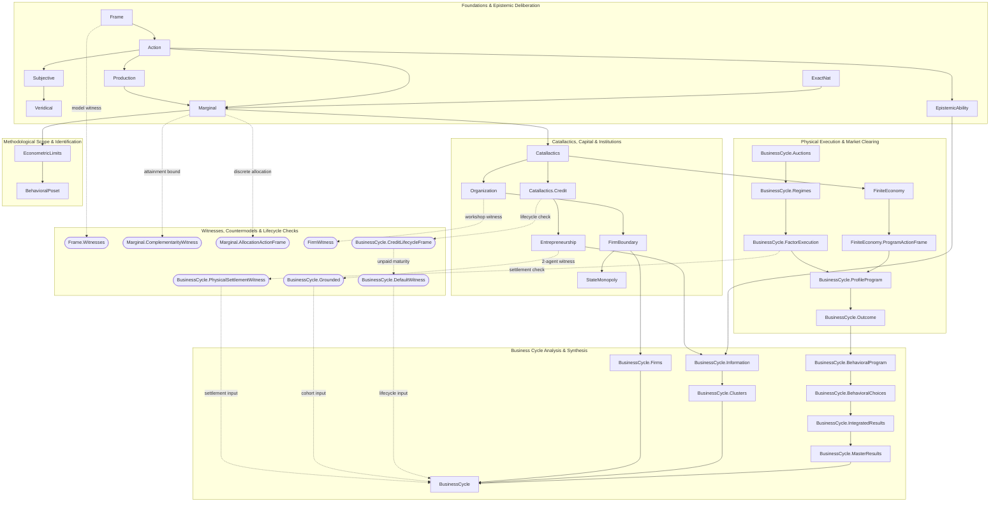

# Formalized Austrian Praxeology in Lean 4

[](https://github.com/leanprover/lean4)
[](https://github.com/leanprover-community/mathlib4)
[](LICENSE)

> **“Human action is an attempt to ease discomfort by making things better. It reflects subjective values under uncertainty: an available option is chosen when its intended result is preferred to doing nothing and no available alternative seems better, while inaction follows when no option seems better. When the options remain available in every situation the actor considers possible, preferring one requires a better result in at least one, while an option that does no worse in any and better in one must be preferred. Even then, the intended result may not be achieved.”**

A machine-checked mathematical development of formal models motivated by Austrian praxeology. It covers purposeful choice, subjective valuation, intertemporal choice, exchange, monetary coordination, entrepreneurial error, and institutional constraints. Individual results are conditional on the definitions, model structures, and hypotheses stated in Lean.

The project develops a formal framework connecting modeled purposeful choice to physical feasibility, exchange, information, and institutional organization. The exact scope and assumptions of headline results are recorded in [`spec/claims_and_assumptions.md`](spec/claims_and_assumptions.md). Formal validity and fidelity to Mises, Menger, Rothbard, or other economic writing are separate questions.

> [!NOTE]
> **Notice & Disclaimer:** This project is an independent, AI-assisted formalization based on the broader literature cited in [References](#references). After initial development was underway, the project was informally refined against the paper *"A Formalization of Austrian Economics"* (Komendarczyk, Rafał, Block, Walter E., Levendis, John, & Tipler, Frank) and their repository [`rafkom72/praxeology-lean`](https://github.com/rafkom72/praxeology-lean).
>
> It is not officially affiliated with or endorsed by the authors. For their authoritative academic formalization, see their paper ([arXiv:2606.18292](https://arxiv.org/abs/2606.18292)) and repository. See [`spec/komendarczyk_contrast.md`](spec/komendarczyk_contrast.md) for a technical comparison with their base system.

## Contents

- [Mathematical architecture](#mathematical-architecture)
- [Module architecture and dependency flow](#module-architecture-and-dependency-flow)
- [Epistemic action and feasibility](#epistemic-action-and-feasibility)
- [Formal coverage](#formal-coverage)
- [Models, countermodels, and methodological scope](#models-countermodels-and-methodological-scope)
- [Documentation and repository organization](#documentation-and-repository-organization)
- [Building and verification](#building-and-verification)
- [References](#references)

## Mathematical architecture

[The common formal framework](Praxeology/Frame/Core.lean#L312) supplies an ontology of agents, moments, histories, actions, means, and ends. Its structural conditions connect five components:

1. **Branching time and agency.** Histories are maximal temporal chains. History extensionality identifies histories with the same incident moments; no choice between undivided histories constrains enacted actions on histories sharing a strict future moment. Feasible actions have realizable choice cells, including a passive baseline.
2. **Physical feasibility and transitions.** Finite menus distinguish contemplated actions from feasible actions. Endowments, input requirements, production yields, and bilateral transfers constrain resource use. Multi-step inventory accounting and optional service yields are handled in [`Production.lean`](Praxeology/Production.lean).
3. **Ordinal evaluation.** A shared requirement schedule applies to ends, while subjective valuation identifies which ends matter to an agent at a decision situation. The core account needs no separate domains for wants or services. Asymmetric preference supports strict comparison without cardinal utility; results needing transitivity or stronger order properties state those assumptions separately.
4. **Deliberation and counterfactuals.** Minimal plausibility, projected decision moments, branch selection, and expected maturation make the evaluated alternative explicit. The [action module](Praxeology/Action.lean) and [`Entrepreneurship`](Praxeology/Entrepreneurship.lean) distinguish ordinary branch comparisons from regret grounded in shared causal contexts.
5. **Explicit bridges.** Physical stocks and numerical inequalities do not imply a choice by themselves. Applications state the preference, feasible-menu, and execution conditions that connect an accounting result to an action conclusion.

With the agent, moment, and history fixed, the formal predicate is:

```math
\begin{aligned}
\text{PurposefulAct}(\alpha^{\ast})\iff{}&
\alpha^{\ast}\in A_{\mathrm{feas}}\ \wedge\ \text{Exec}(\alpha^{\ast})\\
&\wedge\bigl(\alpha^{\ast}=\alpha_0\ \vee\ \text{EndOf}(\alpha^{\ast})\succ\text{EndOf}(\alpha_0)\bigr)\\
&\wedge\forall\beta\in A_{\mathrm{feas}},\ \neg\bigl(\text{EndOf}(\beta)\succ\text{EndOf}(\alpha^{\ast})\bigr).
\end{aligned}
```

Execution includes incidence of the decision moment on the history. The baseline clause permits purposeful inaction; an active action must improve on it. The final clause rules out an action if a feasible alternative leads to a strictly preferred end. Preferences may be incomplete, so ties and incomparable ends are allowed. This is a criterion for modeled purposeful action, not a claim that the actor consciously calculates an optimum.

The formal predicate is [`PurposefulAct`](Praxeology/Action.lean#L232) in [`Action.lean`](Praxeology/Action.lean).

The choice is judged by the actor’s own preference at that moment; the account does not require every pair of ends to be ranked. It also connects these preferences to the outcomes the actor regards as plausible. When both courses are feasible in those circumstances, preferring one end over another is supported by a favorable outcome in at least one plausible circumstance. Conversely, if one course’s outcome is at least as good in every plausible circumstance and better in one, that supports preferring its end. Thus, when available courses remain open across the circumstances considered, an active purposeful choice has support over inaction in at least one such circumstance, and no rival is better in all of them. These are conditional implications of the account of uncertainty, not extra clauses in the definition of purposeful choice. Economic applications combine purposeful choice with their own technological, informational, or institutional conditions. Unordered economic collections use [`Finset`](https://leanprover-community.github.io/mathlib4_docs/Mathlib/Data/Finset/Basic.html); [`List`](https://leanprover-community.github.io/mathlib4_docs/Mathlib/Data/List/Basic.html) is used where order matters, including sequential records and deterministic search.

## Module architecture and dependency flow

The modules share common foundations and combine them in economic applications. This diagram organizes the library into conceptual subsystems, where solid arrows (`-->`) denote primary conceptual and architectural dependencies, and dashed arrows (`-.->`) with stadium nodes (`([ ... ])`) denote concrete witnesses, countermodels, and contractual lifecycle checks.



The chart shows selected module dependencies; solid arrows denote conceptual and architectural flows, while dashed arrows and stadium nodes represent concrete models, empirical witnesses, and contractual lifecycle checks. Each module is linked in the coverage table below, and the root [`Praxeology.lean`](Praxeology.lean) module re-exports the public library modules.

### Axioms and assumptions

The project declares no custom Lean [`axiom`](https://lean-lang.org/doc/reference/latest/Axioms/) and has no unfinished [`sorry`](https://lean-lang.org/doc/reference/latest/Axioms/) proofs. Its transitive axiom audit reports standard Lean dependencies such as [`Classical.choice`](https://lean-lang.org/doc/reference/latest/Axioms/), [`Quot.sound`](https://lean-lang.org/doc/reference/latest/Axioms/), and [`propext`](https://lean-lang.org/doc/reference/latest/Axioms/). These dependencies are distinct from importing Mathlib; neither the use nor avoidance of Mathlib determines soundness. The accepted axiom set and economic premises are documented in the [claim and assumption register](spec/claims_and_assumptions.md).

## Epistemic action and feasibility

The library separates physical feasibility, subjective deliberation, and epistemic know-how:

- **Purposeful Choice & Preference:** [`Action.lean`](Praxeology/Action.lean) defines purposeful choice using an asymmetric preference relation and a finite modeled feasible menu. Transitivity or completeness is added only where a result explicitly requires it.
- **Epistemic Guarantees & Know-How:** [`EpistemicAbility.lean`](Praxeology/EpistemicAbility.lean) formalizes deliberative ability, indistinguishability, and causal execution over choice cells.
- **Physical Inventory & Transitions:** [`Production.lean`](Praxeology/Production.lean) models stock-flow conservation, inventory runs, and service yields along branching histories.
- **Firms & Delegation:** [`Organization.lean`](Praxeology/Organization.lean) and [`FirmWitness.lean`](Praxeology/FirmWitness.lean) model contractual task assignment, internal authority, and market boundaries.
- **Catallactics, Credit & Cycles:** [`Catallactics/Credit.lean`](Praxeology/Catallactics/Credit.lean), [`Entrepreneurship.lean`](Praxeology/Entrepreneurship.lean), and [`BusinessCycle.lean`](Praxeology/BusinessCycle.lean) formalize conditional exchange, loan accounting, investment, and completion-shortage results. The named five-project program includes early-input purchases, one-to-one capital formation, household deposit origination and redemption, and contractual unpaid-maturity settlement. Its household-transfer illustration assumes two initial household money units and transfers two to the bank; `fiveProjectRegimeDataWithHouseholdMoney` exposes these inputs. The transfer creates a deposit claim and bank liability only when the exchange matches. The finite household menu varies deposit, consumption, and offered quantities, and `BehavioralChoices` proves the selected household plan purposeful under its stated preference. `IntegratedResults` proves contextual regret for the two marginal borrowers' actual default branches relative to declining their loans, using the frame's deterministic branch selector and collateral-first preference. `BehavioralProgram` and `IntegratedResults` also prove subjective purposefulness of these borrowers' acceptances under the separately stated four-factor forecast; that forecast is not inferred from the actual household plan. Branches recompute later markets from actual matched advances and offered factors while preserving assigned terms and the stated participation rule. Legal foreclosure is outside the model.

## Formal coverage

The root module [`Praxeology.lean`](Praxeology.lean) imports the public library modules. The principal modules and their roles are:

| Module | Principal mathematical content |
|---|---|
| [Frame](Praxeology/Frame.lean) | Branching-time histories, action menus, endowments, preferences, ends, and physical transition laws |
| [Frame.Witnesses](Praxeology/Frame/Witnesses.lean) | Finite branching models and bilateral trade ActionFrame witnesses |
| [Action module](Praxeology/Action.lean) | Purposeful choice, preference, opportunity costs, plausible histories, and contextual regret |
| [Subjective](Praxeology/Subjective.lean) | Subjective scenario systems, independent carrier type, observation agreement, appraisal rules, and purposefulness certificates |
| [Veridical](Praxeology/Veridical.lean) | Veridical scenario embeddings, cross-forecast physical inventory invariance theorems, and domain veridical instances |
| [Production](Praxeology/Production.lean) | Inventory steps and runs, additive stock balances, and external service accounting |
| [ExactNat](Praxeology/ExactNat.lean) | Exact natural-number remainders and additive certificates |
| [FiniteSupport](Praxeology/FiniteSupport.lean) | Reusable finite-set support results |
| [Marginal](Praxeology/Marginal.lean) | Legacy allocation interfaces, intertemporal preference results, and imports for the revised allocation and complementarity developments |
| [Marginal.AllocationChoice](Praxeology/Marginal/AllocationChoice.lean) | Stock-independent ranked-use technology, local ordinal laws, derived ranked-prefix choice, capacity tables, satiation, and countermodels for incomplete menus or missing replacement laws |
| [Marginal.AllocationActionFrame](Praxeology/Marginal/AllocationActionFrame.lean) | Complete finite allocation menus and purposeful ranked-prefix actions at distinct one-unit and two-unit stocks in one ActionFrame |
| [Marginal.ComplementarityWitness](Praxeology/Marginal/ComplementarityWitness.lean) | Explicit left/right shoe requirements, the walking attainment boundary, and bounded-menu satiation |
| [EpistemicAbility](Praxeology/EpistemicAbility.lean) | Choice-cell guarantees, causal ability, knowledge, and know-how |
| [Catallactics](Praxeology/Catallactics.lean) | Exchange, comparative advantage, monetary adoption, prices, and calculation |
| [Catallactics.Credit](Praxeology/Catallactics/Credit.lean) | Loan lifecycle and fiduciary issuance accounting; contractual repayment is stored directly and the derived rational nominal rate can be positive, zero, or negative |
| [Organization](Praxeology/Organization.lean) | Delegation, instructions, internal transfers, and independent market interfaces |
| [Entrepreneurship](Praxeology/Entrepreneurship.lean) | Credit, investment, capital formation, completion bottlenecks, and regret |
| [FirmBoundary](Praxeology/FirmBoundary.lean) | Price boxes, information, production traces, and organizational choice |
| [FirmWitness](Praxeology/FirmWitness.lean) | A finite workshop and its action, production, transfer, and sale sequence |
| [BusinessCycle](Praxeology/BusinessCycle.lean) | Public synthesis of conditional cycle, information, cohort, firm, one-project, unpaid-maturity, behavioral-choice, and contextual-regret results |
| [BusinessCycle.Information](Praxeology/BusinessCycle/Information.lean) | ActionFrame-indexed Catallactics signals, observation-based knowledge, and policy response |
| [BusinessCycle.Clusters](Praxeology/BusinessCycle/Clusters.lean) | Conditional ActionFrame cohort results for shared-input and price squeezes, with regret composition |
| [BusinessCycle.CreditLifecycleFrame](Praxeology/BusinessCycle/CreditLifecycleFrame.lean) | Multi-stage credit lifecycle events, advances, repayments, and finite tree branches |
| [BusinessCycle.DefaultWitness](Praxeology/BusinessCycle/DefaultWitness.lean) | Separate unpaid-maturity path through an unmatched repayment acceptance; aggregate collateral inventory includes an intervening matched advance, with legal title and foreclosure outside that frame |
| [BusinessCycle.Auctions](Praxeology/BusinessCycle/Auctions.lean) | Deterministic loan bids and factor-price clock; projected reservation preferences and price-affordability calculations |
| [BusinessCycle.Regimes](Praxeology/BusinessCycle/Regimes.lean) | Three five-project source-and-use scenarios, projected and forecast-price calculations, and sufficient-input boundary calculations; cash endowment and transfer remain explicit premises |
| [BusinessCycle.FactorExecution](Praxeology/BusinessCycle/FactorExecution.lean) | Physical note issuance, household deposit exchange, loan advances, early-input purchases, capital formation, factor purchases, completion, output sales, repayment, and contractual settlement |
| [BusinessCycle.ProfileProgram](Praxeology/BusinessCycle/ProfileProgram.lean) | Recursive ActionFrame adapter with a finite household plan menu and branch-state market clearing; records matched transactions and contractual outcomes but does not prove purposeful household or entrepreneur choices |
| [BusinessCycle.Outcome](Praxeology/BusinessCycle/Outcome.lean) | Projection that bundles interpreter-derived inventories and services with matched deposit, credit, default, and collateral records |
| [BusinessCycle.BehavioralProgram](Praxeology/BusinessCycle/BehavioralProgram.lean) | Project-two ActionFrame menu, local observation, four-factor forecast, and subjective purposeful acceptance proof |
| [BusinessCycle.BehavioralChoices](Praxeology/BusinessCycle/BehavioralChoices.lean) | Purposeful household saving under an explicit terminal preference and finite plan menu |
| [BusinessCycle.IntegratedResults](Praxeology/BusinessCycle/IntegratedResults.lean) | Project-three forecast-based purposeful acceptance plus project-two and project-three contextual-regret witnesses for their actual default branches |
| [BusinessCycle.MasterResults](Praxeology/BusinessCycle/MasterResults.lean) | Parameterized master theorem synthesizing the eight causal links of Austrian Business Cycle Theory from credit expansion to purposeful entry, factor squeeze, malinvestment, defaults, and ex-post regret |
| [BusinessCycle.PhysicalSettlementWitness](Praxeology/BusinessCycle/PhysicalSettlementWitness.lean) | Physical settlement witness verifying that matched repayments clear obligations and return collateral independently of behavioral certificates |
| [FiniteEconomy.ProfileSchedule](Praxeology/FiniteEconomy/ProfileSchedule.lean) | Generic compiler from well-formed proposed profiles plus explicitly listed alternatives to a branching physical program with pre-state affordability, idle actions, unilateral branches, and an executed-history witness |
| [BusinessCycle.Firms](Praxeology/BusinessCycle/Firms.lean) | Organized-firm specialization of the single-project entrepreneurial cycle |
| [BusinessCycle.Grounded](Praxeology/BusinessCycle/Grounded.lean) | Finite two-agent ActionFrame witness for one entrepreneur's investment and contextual regret |
| [FiniteEconomy](Praxeology/FiniteEconomy.lean) | Finite histories, physical states, execution, markets, and supply-chain examples |
| [StateMonopoly](Praxeology/StateMonopoly.lean) | Territorial institutions, fiscal accounting, and political choice |
| [EconometricLimits](Praxeology/EconometricLimits.lean) | Observational equivalence and limits of causal identification |
| [BehavioralPoset](Praxeology/BehavioralPoset.lean) | Context-dependent ordinal choice, framing, and behavioral representation |

The modules combine general conditional results with some finite witnesses and countermodels. Many business-cycle cluster theorems are generic over supplied `ActionFrame` instances and evidence structures; these are not, by themselves, a concrete finite business-cycle witness. Each theorem's hypotheses bound its conclusion.

## Models, countermodels, and methodological scope

The library combines consequences of its formal definitions with conditional mechanisms, selected finite models, and countermodels:

- **Concrete instances:** The workshop and finite-economy modules exhibit particular models. They establish non-vacuity only for the structures and properties actually instantiated in those files.
- **Conditional bounds and impossibility results:** For example, a cohort with two distinct borrowers and a separate common lender needs at least three agents. The conclusion is about the stated cohort structure; it does not establish that a credit-cycle mechanism exists in every such frame.
- **Economic interpretations:** Some modules connect physical accounting, preferences, and institutions. Read the hypotheses of the cited theorem and the [claim and assumption register](spec/claims_and_assumptions.md) before treating a formal result as a general economic claim.

## Documentation and repository organization

- [`natural_language/`](natural_language/README.md) contains fourteen draft chapters. They are pending reconciliation with the current formalization and are not yet authoritative translations of the Lean development.
- [`spec/`](spec/README.md) organizes the mathematical specifications and their Lean correspondence by topic.
- [`spec/claims_and_assumptions.md`](spec/claims_and_assumptions.md) records the scope and assumptions of headline claims.
- [`Praxeology/`](Praxeology/) contains the formal library; [`Praxeology.lean`](Praxeology.lean) is its root module.
- [`critiques/`](critiques/) contains methodological essays and comparisons with alternative economic formulations.
- [`scripts/`](scripts/) contains documentation, link, and axiomatic-floor checks.

The Lean declarations are authoritative for exact formal hypotheses and conclusions. Prose specifications are being corrected to track them; economic fidelity remains a separate interpretive question.

## Building and verification

The toolchain and Mathlib revision are pinned in [`lean-toolchain`](lean-toolchain), [`lakefile.toml`](lakefile.toml), and [`lake-manifest.json`](lake-manifest.json). The build commands use [Lake](https://lean-lang.org/doc/reference/latest/Build-Tools-and-Distribution/Lake/). With Lean's toolchain manager installed, run from the repository root:

```bash
lake exe cache get
lake build
python3 scripts/update_theorem_links.py --check
python3 scripts/fix_markdown_math.py --check
python3 scripts/check_markdown_math.py
python3 scripts/audit_axiomatic_floor.py
python3 scripts/audit_constructive_axioms.py --by-axiom --limit 20
```

The build checks formal declarations and configured linters. The declaration-link checker, Markdown math checks, and constructive axiom report are verification tools. The source-pattern premise and axiomatic-floor scripts are advisory only: a textual pattern cannot decide semantic validity or fidelity. The constructive audit's [`--by-axiom`](scripts/audit_constructive_axioms.py) option reports transitive dependencies; `--strict` is for projects that specifically require an axiom-free result, not the default validity criterion. No current finite business-cycle calibration should be read as a historical case study.

## References

1. **Cachanosky, Nicolás, & Padilla, Alexandre.** (2016). "A Mathematical Version of Garrison's Model". *The Quarterly Journal of Austrian Economics*, 19(3), 225–247.
2. **Coase, Ronald H.** (1937). "The Nature of the Firm". *Economica*, 4(16), 386–405.
3. **Hayek, Friedrich A.** (1945). "The Use of Knowledge in Society". *The American Economic Review*, 35(4), 519–530.
4. **Hülsmann, Jörg Guido.** (1998). "Toward a General Theory of Error Cycles". *The Quarterly Journal of Austrian Economics*, 1(4), 1–23.
5. **Hülsmann, Jörg Guido.** (2002). "A Theory of Interest". *The Quarterly Journal of Austrian Economics*, 5(4), 77–110.
6. **Hülsmann, Jörg Guido.** (2003). "Facts and Counterfactuals in Economic Law". *Journal of Libertarian Studies*, 17(1), 57–102.
7. **Komendarczyk, Rafał, Block, Walter E., Levendis, John, & Tipler, Frank J.** (2026). "A Formalization of Austrian Economics: Praxeological Foundations: The Base System and Its Derived Theorems". *arXiv:2606.18292v3 [econ.TH]*. Code repository: [rafkom72/praxeology-lean](https://github.com/rafkom72/praxeology-lean).
8. **Lawson, Gary S.** (2022). "The Epistemology of Second Best". *Texas Law Review*, 100(4), 747–785.
9. **Megger, Dawid.** (2024). "Demonstrated preference in the Austrian economic analysis". *Philosophical Problems in Science (Zagadnienia Filozoficzne w Nauce)*, 76, 391–423.
10. **Menger, Carl.** (1871). *Grundsätze der Volkswirtschaftslehre* (*Principles of Economics*). Wilhelm Braumüller.
11. **Menger, Carl.** (1892). "On the Origin of Money". *The Economic Journal*, 2(6), 239–255.
12. **Mises, Ludwig von.** (1920). "Economic Calculation in the Socialist Commonwealth" ("Die Wirtschaftsrechnung im sozialistischen Gemeinwesen"). *Archiv für Sozialwissenschaft und Sozialpolitik*, 47, 86–121.
13. **Mises, Ludwig von.** (1929). *Critique of Interventionism* (*Kritik des Interventionismus*). Gustav Fischer.
14. **Mises, Ludwig von.** (1949). *Human Action: A Treatise on Economics*. Yale University Press.
15. **Rothbard, Murray N.** (1956). "Toward a Reconstruction of Utility and Welfare Economics". In M. Sennholz (Ed.), *On Freedom and Free Enterprise: Essays in Honor of Ludwig von Mises* (pp. 224–262). D. Van Nostrand.
16. **Rothbard, Murray N.** (1962). *Man, Economy, and State: A Treatise on Economic Principles* (with *Power and Market*). D. Van Nostrand.
17. **van Berkel, Kees, & Lyon, Tim.** (2021). "The Varieties of Ought-implies-Can and Deontic STIT Logic". In *Deontic Logic and Normative Systems: 15th International Conference, DEON 2020/2021* (pp. 57–76). College Publications. Also available as *arXiv:2604.00967*.
18. **Vienneau, Robert.** (2026). "The Production of Commodities and the Structure of Production". *MPRA Paper No. 128751*, University Library of Munich.
