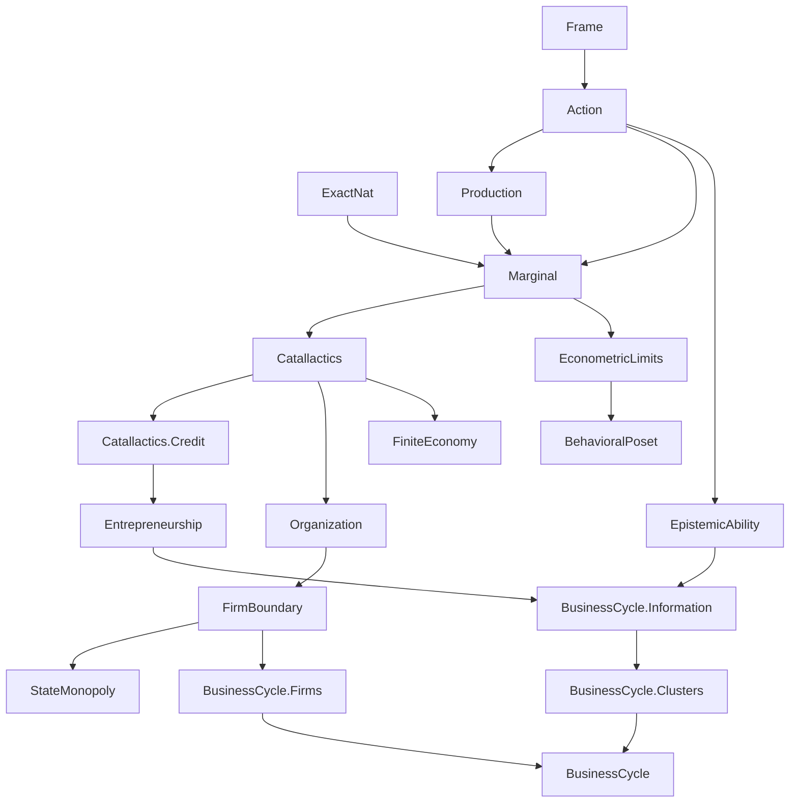

# Formalized Austrian Praxeology in Lean 4

[](https://github.com/leanprover/lean4)
[](https://github.com/leanprover-community/mathlib4)
[](LICENSE)

> **“Human action is an attempt to ease discomfort by making things better. It reflects subjective values under uncertainty: an available option is chosen when its intended result is preferred to doing nothing and no available alternative seems better, while inaction follows when no option seems better. When the options remain available in every situation the actor considers possible, preferring one requires a better result in at least one, while an option that does no worse in any and better in one must be preferred. Even then, the intended result may not be achieved.”**

A machine-checked mathematical development of purposeful action, subjective valuation, intertemporal choice, exchange, monetary coordination, entrepreneurial error, and institutional constraints. The library connects Austrian economic theory with branching-time semantics, ordinal order theory, epistemic models, and explicit causal resource accounting.

The project develops an integrated formal framework connecting purposeful choice to physical feasibility, exchange, information, and institutional organization. Its results state the resource constraints, feasible alternatives, and subjective valuations needed for each conclusion.

> [!NOTE]
> **Notice & Disclaimer:** This project is an independent, AI-assisted formalization based on the broader literature cited in [References](#references). After initial development was underway, the project was informally refined against the paper *"A Formalization of Austrian Economics"* (Komendarczyk, Rafał, Block, Walter E., Levendis, John, & Tipler, Frank) and their repository [`rafkom72/praxeology-lean`](https://github.com/rafkom72/praxeology-lean).
>
> It is not officially affiliated with or endorsed by the authors. For their authoritative academic formalization, see their paper ([arXiv:2606.18292](https://arxiv.org/abs/2606.18292)) and repository. See [`spec/komendarczyk_contrast.md`](spec/komendarczyk_contrast.md) for a technical comparison with their base system.

## Contents

- [Mathematical architecture](#mathematical-architecture)
- [Module architecture and dependency flow](#module-architecture-and-dependency-flow)
- [Epistemic action and feasibility](#epistemic-action-and-feasibility)
- [Formal coverage](#formal-coverage)
- [Models, countermodels, and methodological scope](#models-countermodels-and-methodological-scope)
- [Documentation and repository organization](#documentation-and-repository-organization)
- [Building and verification](#building-and-verification)
- [References](#references)

## Mathematical architecture

[The common formal framework](Praxeology/Frame/Core.lean#L312) supplies an ontology of agents, moments, histories, actions, means, and ends. Its structural conditions connect five components:

1. **Branching time and agency.** Histories are maximal temporal chains. History extensionality identifies histories with the same incident moments; no choice between undivided histories constrains enacted actions on histories sharing a strict future moment. Feasible actions have realizable choice cells, including a passive baseline.
2. **Physical feasibility and transitions.** Finite menus distinguish contemplated actions from feasible actions. Endowments, input requirements, production yields, and bilateral transfers constrain resource use. Multi-step inventory accounting and optional service yields are handled in [`Production.lean`](Praxeology/Production.lean).
3. **Ordinal evaluation.** A shared requirement schedule applies to ends, while subjective valuation identifies which ends matter to an agent at a decision situation. The core account needs no separate domains for wants or services. Asymmetric preference supports strict comparison without cardinal utility; results needing transitivity or stronger order properties state those assumptions separately.
4. **Deliberation and counterfactuals.** Minimal plausibility, projected decision moments, branch selection, and expected maturation make the evaluated alternative explicit. The [action module](Praxeology/Action.lean) and [`Entrepreneurship`](Praxeology/Entrepreneurship.lean) distinguish ordinary branch comparisons from regret grounded in shared causal contexts.
5. **Explicit bridges.** Physical stocks and numerical inequalities do not imply a choice by themselves. Applications state the preference, feasible-menu, and execution conditions that connect an accounting result to an action conclusion.

With the agent, moment, and history fixed, the formal predicate is:

```math
\begin{aligned}
\text{PurposefulAct}(\alpha^{\ast})\iff{}&
\alpha^{\ast}\in A_{\mathrm{feas}}\ \wedge\ \text{Exec}(\alpha^{\ast})\\
&\wedge\bigl(\alpha^{\ast}=\alpha_0\ \vee\ \text{EndOf}(\alpha^{\ast})\succ\text{EndOf}(\alpha_0)\bigr)\\
&\wedge\forall\beta\in A_{\mathrm{feas}},\ \neg\bigl(\text{EndOf}(\beta)\succ\text{EndOf}(\alpha^{\ast})\bigr).
\end{aligned}
```

Execution includes incidence of the decision moment on the history. The baseline clause permits purposeful inaction; an active action must improve on it. The final clause rules out an action if a feasible alternative leads to a strictly preferred end. Preferences may be incomplete, so ties and incomparable ends are allowed. This is a criterion for modeled purposeful action, not a claim that the actor consciously calculates an optimum.

The formal predicate is [`PurposefulAct`](Praxeology/Action.lean#L222) in [`Action.lean`](Praxeology/Action.lean).

The choice is judged by the actor’s own preference at that moment; the account does not require every pair of ends to be ranked. It also connects these preferences to the outcomes the actor regards as plausible. When both courses are feasible in those circumstances, preferring one end over another is supported by a favorable outcome in at least one plausible circumstance. Conversely, if one course’s outcome is at least as good in every plausible circumstance and better in one, that supports preferring its end. Thus, when available courses remain open across the circumstances considered, an active purposeful choice has support over inaction in at least one such circumstance, and no rival is better in all of them. These are conditional implications of the account of uncertainty, not extra clauses in the definition of purposeful choice. Economic applications combine purposeful choice with their own technological, informational, or institutional conditions. Unordered economic collections use [`Finset`](https://leanprover-community.github.io/mathlib4_docs/Mathlib/Data/Finset/Basic.html); [`List`](https://leanprover-community.github.io/mathlib4_docs/Mathlib/Data/List/Basic.html) is used where order matters, including sequential records and deterministic search.

## Module architecture and dependency flow

The modules share common foundations and combine them in economic applications. This compact diagram shows broad composition rather than every import edge. Each box contains module names only.



The chart shows selected module dependencies; each module is linked in the coverage table below, and the root [`Praxeology.lean`](Praxeology.lean) module re-exports the public library modules.

### Axioms and assumptions

The project declares no custom Lean [`axiom`](https://lean-lang.org/doc/reference/latest/Axioms/) and has no unfinished [`sorry`](https://lean-lang.org/doc/reference/latest/Axioms/) proofs. Its transitive axiom audit does report dependencies on Lean and Mathlib axioms, including [`Classical.choice`](https://lean-lang.org/doc/reference/latest/Axioms/), [`Quot.sound`](https://lean-lang.org/doc/reference/latest/Axioms/), and [`propext`](https://lean-lang.org/doc/reference/latest/Axioms/); the [constructive axiom audit](scripts/audit_constructive_axioms.py) reports these by declaration, file, and axiom. Economic premises remain explicit in model fields, scenario data, and theorem hypotheses.

## Epistemic action and feasibility

The library separates physical feasibility, subjective deliberation, and epistemic know-how:

- **Purposeful Choice & Preference:** [`Action.lean`](Praxeology/Action.lean) grounds choice in strict partial orders, characterizing purposeful action, opportunity costs, and contextual regret.
- **Epistemic Guarantees & Know-How:** [`EpistemicAbility.lean`](Praxeology/EpistemicAbility.lean) formalizes deliberative ability, indistinguishability, and causal execution over choice cells.
- **Physical Inventory & Transitions:** [`Production.lean`](Praxeology/Production.lean) models stock-flow conservation, inventory runs, and service yields along branching histories.
- **Firms & Delegation:** [`Organization.lean`](Praxeology/Organization.lean) and [`FirmWitness.lean`](Praxeology/FirmWitness.lean) model contractual task assignment, internal authority, and market boundaries.
- **Catallactics, Credit & Cycles:** [`Catallactics/Credit.lean`](Praxeology/Catallactics/Credit.lean), [`Entrepreneurship.lean`](Praxeology/Entrepreneurship.lean), and [`BusinessCycle.lean`](Praxeology/BusinessCycle.lean) formalize interest-rate determination, fiduciary vs. pure credit expansion, factor-price squeezes, and entrepreneurial malinvestment.

## Formal coverage

The root module [`Praxeology.lean`](Praxeology.lean) imports the public library modules. The principal modules and their roles are:

| Module | Principal mathematical content |
|---|---|
| [Frame](Praxeology/Frame.lean) | Branching-time histories, action menus, endowments, preferences, ends, and physical transition laws |
| [Action module](Praxeology/Action.lean) | Purposeful choice, preference, opportunity costs, plausible histories, and contextual regret |
| [Production](Praxeology/Production.lean) | Inventory steps and runs, additive stock balances, and external service accounting |
| [ExactNat](Praxeology/ExactNat.lean) | Exact natural-number remainders and additive certificates |
| [FiniteSupport](Praxeology/FiniteSupport.lean) | Reusable finite-set support results |
| [Marginal](Praxeology/Marginal.lean) | Finite allocation, imputation, complementarity, and intertemporal choice |
| [EpistemicAbility](Praxeology/EpistemicAbility.lean) | Choice-cell guarantees, causal ability, knowledge, and know-how |
| [Catallactics](Praxeology/Catallactics.lean) | Exchange, comparative advantage, monetary adoption, prices, and calculation |
| [Catallactics.Credit](Praxeology/Catallactics/Credit.lean) | Intertemporal loans, fiduciary issuance, cash-backed solvency, and interest rate spreads |
| [Organization](Praxeology/Organization.lean) | Delegation, instructions, internal transfers, and independent market interfaces |
| [Entrepreneurship](Praxeology/Entrepreneurship.lean) | Credit, investment, capital formation, completion bottlenecks, and regret |
| [FirmBoundary](Praxeology/FirmBoundary.lean) | Price boxes, information, production traces, and organizational choice |
| [FirmWitness](Praxeology/FirmWitness.lean) | A finite workshop and its action, production, transfer, and sale sequence |
| [BusinessCycle](Praxeology/BusinessCycle.lean) | Public synthesis of the cycle, information, cohort, firm, and grounded modules |
| [BusinessCycle.Information](Praxeology/BusinessCycle/Information.lean) | ActionFrame-indexed Catallactics signals, observation-based knowledge, and policy response |
| [BusinessCycle.Clusters](Praxeology/BusinessCycle/Clusters.lean) | Conditional ActionFrame cohort results for shared-input and price squeezes, with regret composition |
| [BusinessCycle.CreditLifecycleFrame](Praxeology/BusinessCycle/CreditLifecycleFrame.lean) | Multi-stage credit lifecycle events, advances, repayments, and finite tree branches |
| [BusinessCycle.Firms](Praxeology/BusinessCycle/Firms.lean) | Organized-firm specialization of the single-project entrepreneurial cycle |
| [BusinessCycle.Grounded](Praxeology/BusinessCycle/Grounded.lean) | Finite two-agent ActionFrame witness for one entrepreneur's investment and contextual regret |
| [FiniteEconomy](Praxeology/FiniteEconomy.lean) | Finite histories, physical states, execution, markets, and supply-chain examples |
| [StateMonopoly](Praxeology/StateMonopoly.lean) | Territorial institutions, fiscal accounting, and political choice |
| [EconometricLimits](Praxeology/EconometricLimits.lean) | Observational equivalence and limits of causal identification |
| [BehavioralPoset](Praxeology/BehavioralPoset.lean) | Context-dependent ordinal choice, framing, and behavioral representation |

The modules combine general conditional results with finite witnesses and countermodels. The business-cycle cluster results are generic over existing `ActionFrame` instances; they add no separate finite economy.

## Models, countermodels, and methodological scope

The library combines general axiomatic deductions with explicit finite models and impossibility proofs:

- **Constructive Inhabitation:** Concrete witnesses (such as the workshop model in [`FirmWitness.lean`](Praxeology/FirmWitness.lean) and multi-stage supply chains in [`FiniteEconomy.lean`](Praxeology/FiniteEconomy.lean)) establish that abstract axiomatic structures (`ActionFrame`, multi-stage production, bilateral trade) are non-vacuous and inhabited.
- **Structural Bounds & Impossibility Theorems:** Formal proofs establish exact lower bounds and impossibilities—such as proving that a multi-project credit cycle requires at least three distinct actors ([`CreditShockCohort.requires_three_agents`](Praxeology/BusinessCycle.lean)), that bilateral frames cannot host multi-borrower cohorts, and that identical clearing rates cannot identify whether credit originated from prior savings or fiduciary expansion without additional source disclosure.
- **Physical & Epistemic Grounding:** All catallactic outcomes are strictly grounded in physical conservation laws (goods cannot be created from nothing) and subjective choice (actions must be contemplated and undominated under the agent's feasible menu).

## Documentation and repository organization

- [`natural_language/`](natural_language/README.md) develops fourteen chapters in prerequisite order, with definitions and proof explanations.
- [`spec/`](spec/README.md) organizes the mathematical specifications and their Lean correspondence by topic.
- [`Praxeology/`](Praxeology/) contains the formal library; [`Praxeology.lean`](Praxeology.lean) is its root module.
- [`critiques/`](critiques/) contains methodological essays and comparisons with alternative economic formulations.
- [`scripts/`](scripts/) contains documentation, link, and axiomatic-floor checks.

The Lean declarations are authoritative for exact hypotheses and conclusions. The prose documents explain their interpretation and mathematical dependencies.

## Building and verification

The toolchain and Mathlib revision are pinned in [`lean-toolchain`](lean-toolchain), [`lakefile.toml`](lakefile.toml), and [`lake-manifest.json`](lake-manifest.json). The build commands use [Lake](https://lean-lang.org/doc/reference/latest/Build-Tools-and-Distribution/Lake/). With Lean's toolchain manager installed, run from the repository root:

```bash
lake exe cache get
lake build
python3 scripts/update_theorem_links.py --check
python3 scripts/fix_markdown_math.py --check
python3 scripts/check_markdown_math.py
python3 scripts/audit_axiomatic_floor.py
python3 scripts/audit_constructive_axioms.py --by-axiom --limit 20
```

The build checks formal declarations and configured linters. The [declaration-link checker](scripts/update_theorem_links.py), [math fixer](scripts/fix_markdown_math.py), [math checker](scripts/check_markdown_math.py), [axiomatic-floor audit](scripts/audit_axiomatic_floor.py), and [constructive axiom audit](scripts/audit_constructive_axioms.py) handle declaration links, mathematical Markdown conventions, the repository's axiomatic-floor policy, and transitive axiom dependencies of all Praxeology declarations. The constructive audit's [`--by-axiom`](scripts/audit_constructive_axioms.py) option gives the current dependency breakdown; add [`--strict`](scripts/audit_constructive_axioms.py) to make the audit fail while any such dependency remains. Economic applications instantiate the stated mechanisms with the relevant institutions, resource constraints, observations, and valuations; numeric parameters can be calibrated when a historical or contemporary case is studied.

## References

1. **Cachanosky, Nicolás, & Padilla, Alexandre.** (2016). "A Mathematical Version of Garrison's Model". *The Quarterly Journal of Austrian Economics*, 19(3), 225–247.
2. **Coase, Ronald H.** (1937). "The Nature of the Firm". *Economica*, 4(16), 386–405.
3. **Hayek, Friedrich A.** (1945). "The Use of Knowledge in Society". *The American Economic Review*, 35(4), 519–530.
4. **Hülsmann, Jörg Guido.** (1998). "Toward a General Theory of Error Cycles". *The Quarterly Journal of Austrian Economics*, 1(4), 1–23.
5. **Hülsmann, Jörg Guido.** (2002). "A Theory of Interest". *The Quarterly Journal of Austrian Economics*, 5(4), 77–110.
6. **Hülsmann, Jörg Guido.** (2003). "Facts and Counterfactuals in Economic Law". *Journal of Libertarian Studies*, 17(1), 57–102.
7. **Komendarczyk, Rafał, Block, Walter E., Levendis, John, & Tipler, Frank J.** (2026). "A Formalization of Austrian Economics: Praxeological Foundations: The Base System and Its Derived Theorems". *arXiv:2606.18292v3 [econ.TH]*. Code repository: [rafkom72/praxeology-lean](https://github.com/rafkom72/praxeology-lean).
8. **Lawson, Gary S.** (2022). "The Epistemology of Second Best". *Texas Law Review*, 100(4), 747–785.
9. **Megger, Dawid.** (2024). "Demonstrated preference in the Austrian economic analysis". *Philosophical Problems in Science (Zagadnienia Filozoficzne w Nauce)*, 76, 391–423.
10. **Menger, Carl.** (1871). *Grundsätze der Volkswirtschaftslehre* (*Principles of Economics*). Wilhelm Braumüller.
11. **Menger, Carl.** (1892). "On the Origin of Money". *The Economic Journal*, 2(6), 239–255.
12. **Mises, Ludwig von.** (1920). "Economic Calculation in the Socialist Commonwealth" ("Die Wirtschaftsrechnung im sozialistischen Gemeinwesen"). *Archiv für Sozialwissenschaft und Sozialpolitik*, 47, 86–121.
13. **Mises, Ludwig von.** (1929). *Critique of Interventionism* (*Kritik des Interventionismus*). Gustav Fischer.
14. **Mises, Ludwig von.** (1949). *Human Action: A Treatise on Economics*. Yale University Press.
15. **Rothbard, Murray N.** (1956). "Toward a Reconstruction of Utility and Welfare Economics". In M. Sennholz (Ed.), *On Freedom and Free Enterprise: Essays in Honor of Ludwig von Mises* (pp. 224–262). D. Van Nostrand.
16. **Rothbard, Murray N.** (1962). *Man, Economy, and State: A Treatise on Economic Principles* (with *Power and Market*). D. Van Nostrand.
17. **van Berkel, Kees, & Lyon, Tim.** (2021). "The Varieties of Ought-implies-Can and Deontic STIT Logic". In *Deontic Logic and Normative Systems: 15th International Conference, DEON 2020/2021* (pp. 57–76). College Publications. Also available as *arXiv:2604.00967*.
18. **Vienneau, Robert.** (2026). "The Production of Commodities and the Structure of Production". *MPRA Paper No. 128751*, University Library of Munich.
