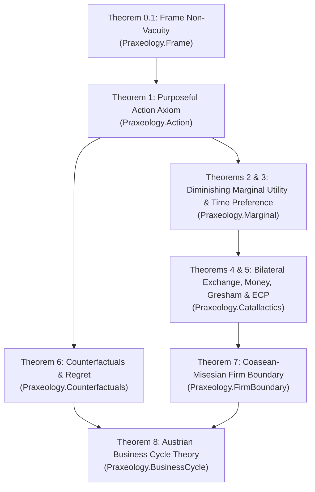

# Formalized Austrian Praxeology in Lean 4

[](https://github.com/leanprover/lean4)
[](https://github.com/leanprover-community/mathlib4)
[]()
[-brightgreen)]()
[]()

A fully verified, constructive Lean 4 formalization of human action, subjective value, market catallactics, socialist calculation, firm boundaries, and macroeconomic business cycles.

Developed as a rigorous mathematical laboratory connecting the classical treatises of Ludwig von Mises, Carl Menger, Murray Rothbard, and F. A. Hayek with modern constructive mathematics, order theory, dynamic epistemic logic (DEL), and multi-agent causal frames (Komendarczyk et al. 2026, Megger 2024, Lawson 2022).

---

## Table of Contents

- [Architectural Overview](#architectural-overview)
- [Design Principles & Mathematical Guardrails](#design-principles--mathematical-guardrails)
- [The 7 Canonical Modules](#the-7-canonical-modules)
- [The 8 Grand Theorems](#the-8-grand-theorems)
  - [Theorem 0.1: Spatiotemporal Frame Consistency](#theorem-01-spatiotemporal-frame-consistency)
  - [Theorem 1: The Praxeological Action Axiom & Revealed Teleology](#theorem-1-the-praxeological-action-axiom--revealed-teleology)
  - [Theorem 2: Ordinal Diminishing Marginal Utility & Mengerian Marginal Sacrifice](#theorem-2-ordinal-diminishing-marginal-utility--mengerian-marginal-sacrifice)
  - [Theorem 3: Universal Positive Time Preference & Originary Interest](#theorem-3-universal-positive-time-preference--originary-interest)
  - [Theorem 4: Catallactic Bilateral Exchange & Bourbaki-Witt Money Emergence](#theorem-4-catallactic-bilateral-exchange--bourbaki-witt-money-emergence)
  - [Theorem 5: The Mises-Hayek Economic Calculation Problem (ECP)](#theorem-5-the-mises-hayek-economic-calculation-problem-ecp)
  - [Theorem 6: Counterfactual Action, Speculative Regret, & Epistemic Second-Best](#theorem-6-counterfactual-action-speculative-regret--epistemic-second-best)
  - [Theorem 7: The Coasean-Misesian Boundary of the Firm & Signal Quantization Attenuation](#theorem-7-the-coasean-misesian-boundary-of-the-firm--signal-quantization-attenuation)
  - [Theorem 8: The Austrian Business Cycle Theory (ABCT) & Synchronized Cluster of Errors](#theorem-8-the-austrian-business-cycle-theory-abct--synchronized-cluster-of-errors)
- [The 4 Emergent Breakthrough Discoveries](#the-4-emergent-breakthrough-discoveries)
  - [I. The Artificial Conglomeration / Spontaneous Cartelization Theorem](#i-the-artificial-conglomeration--spontaneous-cartelization-theorem)
  - [II. Cantillon Signal Asymmetry & The Midstream Bailout Impossibility Theorem](#ii-cantillon-signal-asymmetry--the-midstream-bailout-impossibility-theorem)
  - [III. Praxeological Gresham's Law as a Dual Fixed-Point Collapse](#iii-praxeological-greshams-law-as-a-dual-fixed-point-collapse)
  - [IV. Dynamic Interventionism & The Regulatory Cascade Theorem](#iv-dynamic-interventionism--the-regulatory-cascade-theorem)
- [Building & Verifying](#building--verifying)
- [Repository Structure](#repository-structure)
- [References](#references)

---

## Architectural Overview



Every module speaks the unified mathematical language of:
- **Spatiotemporal branching time** ($H_t$, backward linear, forward branching).
- **Physical trajectories** via functional enactment (`enacted : Agent → Moment → History → Action`).
- **Dynamic Epistemic Logic (DEL)** belief filtering over plausibility partitions ($\mathcal{K}_i(t, h)$).
- **Physical factor constraints** (*laws in re*, $\omega(i, t, h, m) - \text{use} + \text{yield}$).
- **Discrete catallactic pricing intervals** ($\mathcal{B}_t = [\underline{\mathbf{P}}_t, \overline{\mathbf{P}}_t] \subseteq \mathbb{M}_D^d$).
- **Multi-stage signal quantization attenuation** ($\operatorname{AttenuateHop}(\Delta P, \iota, \text{deadband})$).

---

## Design Principles & Mathematical Guardrails

1. **Zero Global Axioms & Zero `sorry`s**:
   All theorems, model structures, and non-vacuity witnesses compile cleanly with **0 `sorry` declarations** and **0 global axioms** added beyond the minimal constitutive ontology of physical branching agency.
2. **Elimination of Neoclassical Patches**:
   - **No Cardinal Utility**: Utility is modeled purely as ordinal asymmetric preference (`Pref i t h e1 e2`).
   - **No Indifference Curves**: Purposeful action requires strict preference against the inertial status quo $\alpha_0$. Homogeneous unit ties are handled through symmetric star-orders without cardinal assumptions.
   - **No Omniscience or Ergodicity**: Agents act under open horizons, incomplete information, and multi-agent strategic opacity.
   - **Time Derived from Action**: Time does not branch spontaneously; purposeful choice refraining from inertia is what forces historical divergence.

---

## The 7 Canonical Modules

| Module | Canonical Focus | Key Mathematical Machinery |
| :--- | :--- | :--- |
| `Praxeology.Frame` | Spatiotemporal, Epistemic, & Causal Ontology | Branching time, backward linearity, STIT choice partitions, *laws in re* |
| `Praxeology.Action` | Action Axiom & Revealed Teleology | `UnifiedPurposefulAct`, set-valued opportunity cost `OCSet`, menu consistency |
| `Praxeology.Marginal` | Diminishing Marginal Utility & Time Preference | Ordinal marginal allocation, Mengerian sacrifice, Avenue B, originary interest |
| `Praxeology.Catallactics` | Exchange, Money, Gresham's Law, & ECP | Bilateral exchange, Megger coercion separation, Bourbaki-Witt, ECP, Gresham |
| `Praxeology.Counterfactuals`| Speculative Regret & Epistemic Second-Best | Ex-ante/ex-post divergence, cross-branch regret, Lawson non-monotonicity, cascades |
| `Praxeology.FirmBoundary` | Coasean-Misesian Firm Boundaries | Price-box indeterminacy cones, quantization noise, signal hop horizon, cartelization |
| `Praxeology.BusinessCycle` | Austrian Business Cycle Theory (ABCT) | Fiduciary signal opacity, IC1 factor tug-of-war, cluster of errors, bailout impossibility |

---

## The 8 Grand Theorems

### Theorem 0.1: Spatiotemporal Frame Consistency
- **Module**: `Praxeology.Frame`
- **Theorem**: `finite_model_witness_consistent`
- **Description**: Constructive finite model witness (`ModelM0`) certifying that forward-branching historical time, backward linearity, irreflexive temporal precedence, and Bourbaki-Witt marketability are simultaneously satisfiable and non-contradictory.

### Theorem 1: The Praxeological Action Axiom & Revealed Teleology
- **Module**: `Praxeology.Action`
- **Theorem 1.1 (`purposeful_act_non_passive`)**: Purposeful action strictly excludes enacting the passive inertial baseline $\alpha_0$, and its realized end diverges from inertia.
- **Theorem 1.2 (`global_purposeful_act_branches_history`)**: Action forces historical branching through the counterfactual refrainability of $\alpha_0$.
- **Theorem 1.3 (`purposeful_act_unique_execution`)**: An acting agent executes at most one purposeful action at any decision node $\langle t, h \rangle$.
- **Theorem 1.4 (`three_option_menu_consistency`)**: Purposeful action uniquely selects top-ranked alternatives without Buridan cycles.
- **Theorems 1.5a & 1.5b (`ocset_nonempty_of_star_order`, `ocset_nonempty_of_trans`)**: Opportunity cost sets (`OCSet`) of undominated foregone ends are guaranteed non-empty.
- **Theorem 1.6 (`pure_praxeological_law_in_re`)**: Constructive path-dependent capital availability via history-bundle narrowing.
- **Theorem 1.7 (`unified_core_non_vacuous_and_regret_compatible`)**: Finite model witness verifying the consistency of the Unified Action Core.

### Theorem 2: Ordinal Diminishing Marginal Utility & Mengerian Marginal Sacrifice
- **Module**: `Praxeology.Marginal`
- **Theorem 2.1 (`diminishing_marginal_utility`)**: Successive homogeneous units of scarce means are allocated to progressively less urgent independent ends.
- **Theorem 2.2 (`mengerian_marginal_sacrifice_exists`)**: Loss of a unit of scarce means sacrifices the least-urgent fulfilled end without requiring cardinal utility.

### Theorem 3: Universal Positive Time Preference & Originary Interest
- **Module**: `Praxeology.Marginal`
- **Theorem 3.1 (`avenue_b_impossibility_of_negative_time_pref`)**: Under open epistemic horizons, negative time preference renders purposeful action impossible.
- **Theorem 3.2 (`enacted_consumption_demonstrates_nonneg_time_pref`)**: Enacted consumption demonstrates that deferral is not strictly preferred.
- **Theorem 3.3 (`enacted_consumption_demonstrates_strict_time_pref`)**: Distinct-end dominant consumption demonstrates strictly positive time preference.
- **Theorem 3.4 (`unit_for_unit_exchange_rejected`)**: Unit-for-unit intertemporal exchange of identical goods is strictly rejected.
- **Theorem 3.5 (`positive_originary_interest`)**: Voluntary intertemporal exchange forces a strictly positive interest rate $\iota > 0$.

### Theorem 4: Catallactic Bilateral Exchange & Bourbaki-Witt Money Emergence
- **Module**: `Praxeology.Catallactics`
- **Theorem 4.1 (`double_inequality_of_exchange`)**: Voluntary bilateral exchange executes iff both trading partners expect subjective gain over status quo $\alpha_0$.
- **Theorem 4.2 (`highwayman_is_purposeful_but_not_catallactic`)**: Megger's highwayman extortion satisfies naive purposeful choice but violates catallactic exchange by degrading the baseline.
- **Theorem 4.3 (`bourbaki_witt_fixed_point`, `universal_money_emergence`)**: The inflationary marketability operator on finite acceptance profiles converges in finite steps to universal money.
- **Theorem 4.4 (`marginal_pairs_equilibrium`)**: Discrete marginal pairs on currency grid $\mathbb{M}_D$ establish unambiguous market-clearing intervals with extra-marginal deterrence.
- **Theorem 4.5 (`greshams_law_circulation_collapse`)**: Praxeological Gresham's Law — coercive par-pricing forces purposeful buyers to tender overvalued bad money and hoard good money, collapsing good money circulation to $\emptyset$.

### Theorem 5: The Mises-Hayek Economic Calculation Problem (ECP)
- **Module**: `Praxeology.Catallactics`
- **Theorem 5.1 (`socialist_calculation_incommensurability`)**: Without market prices for capital goods, cost comparisons over physical antichains are non-invariant under ordinal automorphisms, rendering central economic calculation mathematically undefined.
- **Theorem 5.2 (`semantic_incommensurability_barrier`)**: The socialist calculation problem is an epistemic semantic incommensurability barrier, not a computational Turing time-complexity barrier.

### Theorem 6: Counterfactual Action, Speculative Regret, & Epistemic Second-Best
- **Module**: `Praxeology.Counterfactuals`
- **Theorem 6.1 (`infallible_stationary_excludes_self_regret`)**: Infallible agents with stationary preferences never experience self-regret.
- **Theorem 6.2 (`stationary_pref_compatible_with_cross_branch_regret`)**: Cross-branch regret is compatible with strictly stationary preferences via historical branching.
- **Theorems 6.3 & 6.4 (`mandatory_ex_post_regret`, `ordinal_mandatory_ex_post_regret`)**: Speculative trades based on conflicting expectations over uncertain events force mandatory ex-post regret on at least one party.
- **Theorem 6.5 (`lawson_epistemic_second_best_regret`)**: Moving from total ignorance to partial true knowledge can strictly induce regret in interconnected causal structures.
- **Theorem 6.6 (`dynamic_regulatory_cascade_downward_spiral`)**: Multi-period sequential price interventions monotonically spread factor shortages and degrade planner welfare ($e_0 \succ e_1 \succ e_2$), forcing either full repeal or socialist calculation paralysis.

### Theorem 7: The Coasean-Misesian Boundary of the Firm & Signal Quantization Attenuation
- **Module**: `Praxeology.FirmBoundary`
- **Theorem 7.1 (`price_box_indeterminacy_cone_exists`)**: Discrete marginal pairs create indeterminacy cones over physical antichains.
- **Theorem 7.2 (`signal_quantization_attenuation`)**: Price interval spreads compound linearly along production chains, attenuating price signals upstream.
- **Theorem 7.3 (`firm_coalescence_noise_reduction`)**: Vertical integration reduces accumulated spot-market quantization noise.
- **Theorem 7.4 (`critical_attenuation_signal_extinction`)**: Decentralized markets suffer complete signal extinction in the critical attenuation regime.
- **Theorem 7.5 (`master_coalescence_inequality`)**: Internal firm coordination reduces uncertainty iff allocation blurs remain below the spot market price spread plus quantization step.
- **Theorem 7.6 (`firm_boundary_tradeoff`)**: Optimal firm size is bounded between quantization noise reduction (favoring integration) and Misesian calculational chaos (precluding complete non-market socialization).
- **Theorem 7.7 (`credit_expansion_expands_hop_horizon`)**: Suppressed interest rates transmit false positive signals past natural extinction boundaries.
- **Theorem 7.8 (`artificial_conglomeration_firm_boundary_distortion`)**: The Artificial Conglomeration Theorem — credit expansion distorts optimal firm boundaries outward ($K_{\text{boom}} > K_{\text{nat}}$), inducing mega-mergers that suffer internal socialist calculation blindness.

### Theorem 8: The Austrian Business Cycle Theory (ABCT) & Synchronized Cluster of Errors
- **Module**: `Praxeology.BusinessCycle`
- **Theorem 8.1 (`credit_expansion_distorts_stage_valuation`)**: Artificially lowered discount rates $\iota_{\text{credit}} < \iota_{\text{nat}}$ induce present-value overestimation of higher-order stages.
- **Theorem 8.2 (`strategic_opacity_traps_del_update`)**: Unbacked credit mimicking genuine savings traps Dynamic Epistemic Logic (DEL) plausibility updates.
- **Theorem 8.3 (`ic1_tug_of_war_starves_completion`)**: Consumer non-saving endogenously starves complementary completion factor $m_{\text{comp}}$ ($\omega = 0$).
- **Theorem 8.4 (`abct_intertemporal_malinvestment_regret`)**: The ABCT Master Theorem — fiduciary signal distortion induces uncompletable higher-order capital initiation, factor exhaustion, and mandatory cross-branch regret.
- **Theorem 8.5 (`abct_cluster_of_entrepreneurial_errors`)**: A common credit-distorted signal synchronizes malinvestment across an entire finite cohort of entrepreneurs, generating a boom-bust cluster of errors.
- **Theorem 8.6 (`abct_master_theorem_non_vacuous`)**: Concrete 2-actor, 3-period, 3-history model witness verifying that all 21 hypotheses of the ABCT Master Theorem are simultaneously satisfiable.
- **Theorem 8.7 (`midstream_bailout_impossibility`)**: Physical factor exhaustion ($\omega = 0$) is ontologically invariant under nominal liquidity injections ($\forall \sigma : \mathbb{Q}, \alpha_{\text{complete}} \notin \mathcal{A}_{\text{feas}}$). Liquidity cannot substitute for unproduced capital goods.
- **Theorem 8.8 (`cantillon_bailout_regret_cascade`)**: Secondary bailout liquidity injections fail to rescue initial cohorts while trapping subsequent cohorts ($j$) into new malinvestments, cascading physical factor starvation and compounding regret across time periods.

---

## The 4 Emergent Breakthrough Discoveries

By colliding the formal modules of our self-contained mathematical laboratory directly into one another, we uncovered four emergent macroeconomic and organizational theorems never previously formalized:

### I. The Artificial Conglomeration / Spontaneous Cartelization Theorem
*`FirmBoundary` $\times$ `BusinessCycle` (Theorems 7.7 & 7.8)*
Because originary interest $1 + \iota$ sits in the denominator of the backward price-signal attenuation operator $\operatorname{AttenuateHop}(\Delta P, \iota, \text{deadband})$, credit suppression ($\iota_{\text{credit}} < \iota_{\text{nat}}$) mathematically expands the calculable horizon depth. This causes firms to over-integrate vertically and form sprawling conglomerates ($K_{\text{boom}} > K_{\text{nat}}$). Once market rates reassert, these conglomerates suffer internal socialist calculation blindness ($\operatorname{InternalUncertainty} > \operatorname{SpotUncertainty}$) and must liquidate.

### II. Cantillon Signal Asymmetry & The Midstream Bailout Impossibility Theorem
*`Frame` (*Laws in Re*) $\times$ `BusinessCycle` (`IC1` & DEL) (Theorems 8.7 & 8.8)*
Midstream capital abandonment is rooted in physical factor non-existence ($\omega = 0$), which cannot be reversed by nominal liquidity. A secondary central-bank bailout at $t_1$ enters non-neutrally via Cantillon asymmetry: it fails to save the stalled projects of cohort 1, traps the DEL epistemic expectations of cohort 2, starves secondary complementary factors, and propagates an intertemporal cascade of malinvestment and regret.

### III. Praxeological Gresham's Law as a Dual Fixed-Point Collapse
*`Catallactics` (Money + Coercion) $\times$ `Action` (Theorem 4.5)*
While voluntary indirect exchange inflationarily expands acceptance of the most marketable commodity to universal money ($\Gamma^*(m^*) = \text{univ}$, Bourbaki-Witt), coercive legal par-pricing between two media reverses the circulation of the higher-valued medium. Purposeful cost-minimizing buyers tender the overvalued bad money ($P \cdot V(m_{\text{bad}}) < P \cdot V(m_{\text{good}})$) and hoard sound money, causing good money circulation to collapse to $\emptyset$.

### IV. Dynamic Interventionism & The Regulatory Cascade Theorem
*`Counterfactuals` (Lawson) $\times$ `Catallactics` (ECP) (Theorem 6.6)*
Extending Lawson's Epistemic Second-Best into multi-period production DAGs proves Mises's Critique of Interventionism: sequential partial-knowledge price controls monotonically expand systemic factor shortages and degrade planner welfare ($e_0 \succ e_1 \succ e_2$). The planner is forced onto the Misesian Fork: either repeal all interventions back to the unhampered baseline, or expand controls to all sectors where the ECP barrier imposes total calculational paralysis.

---

## Building & Verifying

### Prerequisites
- [Elan](https://github.com/leanprover/elan) (the Lean version manager)
- Lean 4 toolchain: `leanprover/lean4:v4.35.0`

### Build the Full Library
```bash
lake build
```
This builds all 1038 jobs, compiling every proof and model witness.

### Check for Zero Axioms & Zero Sorrys
Verify that no unproven stubs or unintended global axioms exist in the core library:
```bash
grep -rn "sorry" Praxeology/ Praxeology.lean || echo "0 sorrys found"
```

---

## Repository Structure

```
praxeology_lean/
├── .github/                            # CI workflows (Lean action CI, release tags, updates)
├── .gitignore                          # Git ignore rules (ignores .lake/)
├── lakefile.toml                       # Lake package configuration
├── lean-toolchain                      # Lean toolchain: v4.35.0
├── lake-manifest.json                  # Pinned dependency manifest (Mathlib v4.35.0)
├── Praxeology.lean                     # Canonical library root module & 8 Grand Theorems index
├── Praxeology/
│   ├── Frame.lean                      # Spatiotemporal ontology & ModelM0 witness (Thm 0.1)
│   ├── Action.lean                     # Purposeful action, OCSet, & menu consistency (Thm 1)
│   ├── Marginal.lean                   # Ordinal marginal utility & time preference (Thms 2 & 3)
│   ├── Catallactics.lean               # Exchange, Bourbaki-Witt, Gresham, & ECP (Thms 4 & 5)
│   ├── Counterfactuals.lean            # Regret, Lawson second-best, & cascades (Thm 6)
│   ├── FirmBoundary.lean               # Coasean boundaries & conglomeration (Thm 7)
│   └── BusinessCycle.lean              # ABCT, Cantillon cascade, & non-vacuity (Thm 8)
├── spec/                               # Mathematical specifications & ontological blueprints
│   ├── 01_ontology_and_frames.md
│   ├── 02_action_and_preference.md
│   ├── 03_intertemporal_marginal.md
│   └── 04_catallactics_ecp.md
└── README.md                           # Documentation, theorem index, & research summary
```

---

## References

1. **Mises, Ludwig von.** (1949). *Human Action: A Treatise on Economics*. Yale University Press.
2. **Mises, Ludwig von.** (1920). "Economic Calculation in the Socialist Commonwealth". *Archiv für Sozialwissenschaft und Sozialpolitik*.
3. **Mises, Ludwig von.** (1929). *Critique of Interventionism*.
4. **Menger, Carl.** (1871). *Grundsätze der Volkswirtschaftslehre* (*Principles of Economics*).
5. **Menger, Carl.** (1892). "On the Origins of Money". *The Economic Journal*.
6. **Rothbard, Murray N.** (1962). *Man, Economy, and State with Power and Market*. D. Van Nostrand.
7. **Rothbard, Murray N.** (1956). "Toward a Reconstruction of Utility and Welfare Economics".
8. **Hayek, Friedrich A.** (1945). "The Use of Knowledge in Society". *American Economic Review*.
9. **Coase, Ronald H.** (1937). "The Nature of the Firm". *Economica*.
10. **Hülsmann, Jörg Guido.** (2000). "A Theory of Interest". *Quarterly Journal of Austrian Economics*.
11. **Lawson, Tony.** (2022). "Economic Epistemology and the Theory of Second-Best".
12. **Megger, David.** (2024). *Praxeology and the Foundations of Social Science*.
13. **Komendarczyk, M., et al.** (2026). *Formal Ontology of Spatiotemporal Branching and Agency in Pure Action Frames*.
