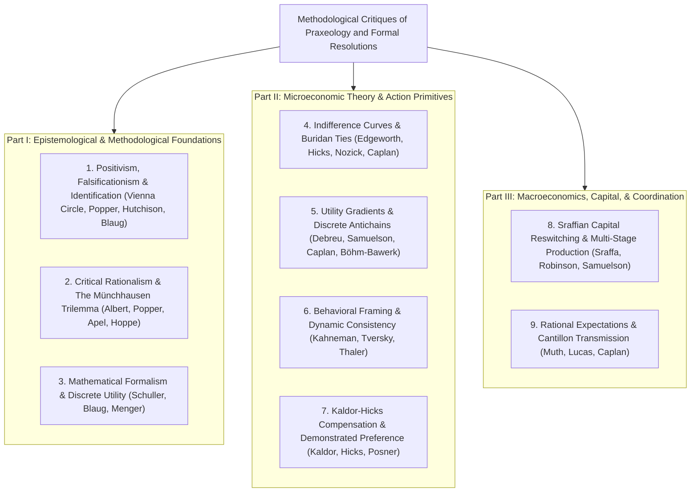

# Methodological Critiques of Praxeology: Epistemology, Choice, and Macroeconomics

## Executive Summary

Over the past century, economists and philosophers from six major traditions have challenged Austrian praxeology.

These traditions include:
- **Logical Positivism** (the Vienna Circle);
- **Critical Rationalism** (Karl Popper and Hans Albert);
- **Mathematical Economics** (Paul Samuelson, Gérard Debreu, Mark Blaug);
- **Behavioral Psychology** (Daniel Kahneman, Amos Tversky, Richard Thaler);
- **Sraffian Capital Theory** (Piero Sraffa, Joan Robinson); and
- **Neoclassical Macroeconomics** (Robert Lucas, Bryan Caplan).

Their challenges raise nine core questions about how we study human action:
1. Must economic theories be tested with statistical data to be scientific?
2. Does praxeology rely on an unchallengeable dogma to avoid philosophical skepticism?
3. Can economic laws like diminishing marginal utility hold without continuous calculus?
4. How do people choose between identical options without an indifference curve?
5. Does consumer choice require calculating calculus derivatives on utility surfaces?
6. Do psychological biases and impulse decisions refute purposeful human action?
7. Can a policy be called "efficient" if it harms people without compensating them?
8. Does capital reswitching disprove Austrian capital and interest theory?
9. Why don't smart business owners anticipate central bank credit booms and avoid busts?

Rather than dismissing these critics with polemics, this treatise examines each challenge in its strongest form.

By grounding each problem in an action frame ([Definition 1.1](../natural_language/01_agents_means_ends_and_feasibility.md#definition-11-the-basic-vocabulary-of-an-action-frame)) and machine-checked logic in Lean 4, we show how praxeology provides clear, mathematically sound answers to all nine questions.

---

## Contents

- [Executive Summary](#executive-summary)
- [Part I: Epistemological & Methodological Foundations](#part-i-epistemological--methodological-foundations)
  - [1. Logical Positivism, Falsificationism, and Econometric Identification](#1-logical-positivism-falsificationism-and-econometric-identification)
  - [2. Critical Rationalism, the Münchhausen Trilemma, and Transcendental Retortion](#2-critical-rationalism-the-münchhausen-trilemma-and-transcendental-retortion)
  - [3. Mathematical Formalism and Discrete Marginal Utility](#3-mathematical-formalism-and-discrete-marginal-utility)
- [Part II: Microeconomic Theory & Action Primitives](#part-ii-microeconomic-theory--action-primitives)
  - [4. Indifference Curve Analysis and Buridan's Ties Dilemma](#4-indifference-curve-analysis-and-buridans-ties-dilemma)
  - [5. Real-Valued Utility Representations and the Marginal Rate of Substitution](#5-real-valued-utility-representations-and-the-marginal-rate-of-substitution)
  - [6. Behavioral Economics and the Tautology Dilemma](#6-behavioral-economics-and-the-tautology-dilemma)
  - [7. Kaldor-Hicks Efficiency and Potential Pareto Compensation](#7-kaldor-hicks-efficiency-and-potential-pareto-compensation)
- [Part III: Macroeconomics, Capital, & Coordination](#part-iii-macroeconomics-capital--coordination)
  - [8. Sraffian Capital Reswitching and Production Structures](#8-sraffian-capital-reswitching-and-production-structures)
  - [9. Rational Expectations and Macro-Intertemporal Neutrality](#9-rational-expectations-and-macro-intertemporal-neutrality)
- [Conclusion](#conclusion)

---

# Part I: Epistemological & Methodological Foundations

## 1. Logical Positivism, Falsificationism, and Econometric Identification

### The Core Dilemma
Critics often ask: *If praxeology deduces economic laws from pure reasoning rather than statistical testing, isn't it unscientific?*

This critique blends two distinct 20th-century movements that must be carefully untangled:

1. **Logical Positivism (The Vienna Circle: Carnap, Schlick, Ayer):**
   - Held that a statement is meaningful only if it is an analytical tautology (like math or pure logic) or empirically verifiable by sensory observation.
   - Positivism collapsed under its own weight: the verification rule itself is neither an analytical tautology nor empirically verifiable, making it meaningless by its own standard.

2. **Popperian Critical Rationalism (Karl Popper, Mark Blaug, Terence Hutchison):**
   - Popper introduced *falsifiability* to dismantle logical positivism, not to defend it.
   - For Popper, falsifiability is a rule of **demarcation** (drawing the boundary between empirical science and non-empirical fields), **not** a test of meaning.
   - Popper explicitly acknowledged that mathematics, formal logic, metaphysics, and ethics are meaningful and truth-apt, even though they cannot be falsified by a laboratory test.
   - Under this demarcation criterion, praxeology—like formal logic, Euclidean geometry, and axiomatic decision theory—is deductive rather than inductive: it formalizes the structural conditions of choice rather than statistical empirical generalizations.

### Formal Specification
In an action frame $W$ ([Definition 1.1](../natural_language/01_agents_means_ends_and_feasibility.md#definition-11-the-basic-vocabulary-of-an-action-frame)), time $\mathcal{T}$ flows forward along strict precedence $\prec$ ([Axiom 2.1](../natural_language/02_time_histories_and_physical_execution.md#axiom-21-strict-temporal-precedence)).

Time branches into distinct histories $h \in \mathcal{H}$ ([Definition 2.3](../natural_language/02_time_histories_and_physical_execution.md#definition-23-histories-as-maximal-chains)).

When an agent chooses an action $\alpha^{\ast} = \text{enacted}(i, t, h)$ ([Definition 2.7](../natural_language/02_time_histories_and_physical_execution.md#definition-27-enacted-actions)), empirical data record only the chosen action and its realized outcome:

$$
\mathcal{O}_{\mathrm{obs}}(W, \text{interp}, i, t, h) = \bigl(\text{enacted}(i, t, h),\; \mathcal{O}_{\text{interp}}(i, \text{enacted}(i, t, h), t, h)\bigr).
$$

Two different theories are observationally equivalent if they produce the exact same historical record:

$$
\text{ObsEquiv}(W, \text{interp}_1, \text{interp}_2, i, t, h) \iff \mathcal{O}_{\mathrm{obs}}(W, \text{interp}_1, i, t, h) = \mathcal{O}_{\mathrm{obs}}(W, \text{interp}_2, i, t, h).
$$

The data never record unchosen options $`\beta \in \mathcal{A}_{\mathrm{feas}}(i, t, h) \setminus \{\alpha^{\ast}\}`$ ([Definition 1.4](../natural_language/01_agents_means_ends_and_feasibility.md#definition-14-action-menus-contemplation-and-feasibility)).

### Proposition 1 (The Fundamental Problem of Causal Identification)
Real-world data capture only the path actually taken. Because unchosen counterfactual alternatives leave zero physical record, observational data alone cannot identify true causal laws without explicit structural assumptions.

**Proof.**
1. **Equal Records Cannot Separate Models:** By [Proposition 14.1](../natural_language/14_historical_observation_and_identification.md#proposition-141-non-identification-from-equal-records), if two theories match on all realized data but disagree on underlying structural parameters $`f(\text{interp}_1) \neq f(\text{interp}_2)`$, no statistical estimator based only on that data can tell them apart.
2. **Unobserved Counterfactuals Can Differ Freely:** By [Proposition 14.2](../natural_language/14_historical_observation_and_identification.md#proposition-142-counterfactual-outcomes-can-vary-without-changing-the-record), we can change the hypothetical outcome of an unchosen alternative $\beta \neq \alpha^{\ast}$ without altering the observed data $`\mathcal{O}_{\mathrm{obs}}`$ by a single bit.
3. **The Lucas Policy Invariance Limit:** By [Theorem 14.3](../natural_language/14_historical_observation_and_identification.md#theorem-143-the-praxeological-lucas-policy-invariance-theorem), if a policy change alters the attractiveness of an unchosen alternative $\beta$, an action that was previously chosen may no longer be purposeful, even though the past historical record looked completely stable.
4. **Underdetermination of Hypotheses:** By [Proposition 14.4](../natural_language/14_historical_observation_and_identification.md#proposition-144-observed-outcomes-need-not-determine-an-exclusion-restriction) and [Theorem 14.7](../natural_language/14_historical_observation_and_identification.md#theorem-147-the-duhem-quine-econometric-underdetermination-theorem), an empirical rejection of a composite hypothesis $\neg(H_1 \land \dots \land H_n)$ tells us that something failed, but data alone cannot pinpoint which specific assumption was wrong. $\blacksquare$

### In Plain Terms: The Bridge to Modern Econometrics
This result directly matches the foundation of modern causal inference (Haavelmo 1944; Rubin 1974; Angrist & Imbens 1994; Heckman 2000, 2010):
- **The Fundamental Problem of Causal Inference:** You can never observe both what happened when a patient took a medicine and what would have happened if they had not.
- **Manski's Law of Decreasing Credibility:** As econometrician Charles Manski (*Identification Problems in the Social Sciences*, 1995) formulated: *"The credibility of inference decreases with the strength of the assumptions maintained."*
- Raw data identify only the realized factual mixture. Point-identifying policy effects requires non-testable structural assumptions.

Praxeology is not "anti-empirical." It simply insists on complete intellectual honesty: before you interpret past historical correlations as invariant causal laws, you must state your structural assumptions about purposeful human choice explicitly.

---

## 2. Critical Rationalism, the Münchhausen Trilemma, and Transcendental Retortion

### The Core Dilemma
Critics ask: *If praxeology claims its Action Axiom is self-evident and indubitable, isn't it guilty of dogmatism?*

German critical rationalist Hans Albert (1968) introduced the **Münchhausen Trilemma**, named after the fictional Baron Münchhausen who pulled himself out of a swamp by his own hair. 

Albert argued that every attempt to establish an infallible foundation for knowledge (*Letztbegründung*) must fail by hitting one of three dead-ends:
1. **Infinite Regress:** Every justifying premise requires another premise, backwards forever.
2. **Logical Circularity:** The conclusion is quietly assumed in the premises.
3. **Dogmatic Stoppage:** The chain of reasons is arbitrarily stopped at a favored principle that is declared immune to criticism.

### The Austrian Defense: Retortion
Austrian economists (notably Hans-Hermann Hoppe, adapting discourse ethics from Karl-Otto Apel and Jürgen Habermas) answered with the **transcendental argument from retortion**:
- Anyone trying to argue that "human action does not exist" must engage in debate.
- But debating requires purposeful action: allocating scarce time, selecting words, and trying to achieve a goal.
- Therefore, denying action creates an immediate *performative self-contradiction*.

### Four Crucial Nuances
While clever, this defense has four important limitations that critical rationalists emphasize:

1. **Pragmatic Rules vs. Metaphysical Truth (The Albert–Apel Debate):**
   - Proving that an opponent cannot deny a statement in debate without contradicting themselves shows a rule of human communication, not an infallible fact about physical reality.
   - Declaring an axiom immune to criticism because it is presupposed in dialogue is what Albert calls a sophisticated form of **Dogmatic Stoppage** (Horn 3).

2. **The Speech Act vs. Propositional Truth (Methodological Dualism):**
   - Saying *"I am not speaking right now"* is a performative contradiction when spoken aloud. Yet the statement itself ("Person $i$ is not speaking at time $t$") is completely logical and true most of the time.
   - An interlocutor arguing that human behavior is governed by deterministic brain chemistry uses vocal cords, but this pragmatic speech does not by itself disprove physical determinism.
   - Mises understood this boundary well. In *Human Action*, he adopted **methodological dualism**: praxeology does not claim to solve the metaphysical mind-body problem; rather, because science does not know the exact physical bridge laws from brain states to conscious thoughts, economics must treat human action teleologically.

3. **The Role of the ActionFrame vs. Contingent Historical Branches:**
   - The bare sentence "Man acts" cannot by itself deduce the laws of banking, money, or business cycles.
   - In this formalization, `ActionFrame` ([Definition 1.1](../natural_language/01_agents_means_ends_and_feasibility.md#definition-11-the-basic-vocabulary-of-an-action-frame)) is the constitutive ontology of action: time ([Axiom 2.1](../natural_language/02_time_histories_and_physical_execution.md#axiom-21-strict-temporal-precedence)), physical scarcity ([Definition 3.1](../natural_language/03_preference_purpose_and_opportunity_cost.md#definition-31-physical-scarcity-predicate)), matter conservation ([Axiom 2.12](../natural_language/02_time_histories_and_physical_execution.md#axiom-212-physical-matter-conservation-and-inventory-transition)), and preference asymmetry ([Axiom 3.3](../natural_language/03_preference_purpose_and_opportunity_cost.md#axiom-33-strict-asymmetry-of-preference)) are intrinsic to choice itself.
   - Specific market institutions (like barter vs. money in [Definition 9.11](../natural_language/09_money_prices_and_calculation.md#definition-911-demand-connectivity-across-trading-links), or cash loans in [Proposition 10.10](../natural_language/10_entrepreneurship_credit_and_investment.md#proposition-1010-physical-effects-of-note-issuance)) are historical branches within the frame, not truths proved by speech-act retortion alone.

4. **Foundationalism vs. Fallibilism:**
   - Critical rationalists reject the search for absolute certainty.
   - Lean 4 does not claim dogmatic perfection. Instead, it provides **auditable conditional deductions** ($H \vdash C$): every premise is declared explicitly, machine-checked, and open to public inspection.

### Formal Specification
Chapter 6 distinguishes the physical utterance of a sentence from its propositional meaning ([Definition 6.7](../natural_language/06_knowledge_ability_and_communication.md#definition-67-utterance-and-assertion)):

$$
\begin{aligned}
\text{Utters}(i, t, h, \alpha) &\iff \alpha \in \mathcal{A}_{\mathrm{feas}}(i, t, h) \land \text{enacted}(i, t, h) = \alpha, \\
\text{Asserts}(i, t, h, P, \alpha) &\iff \text{Utters}(i, t, h, \alpha) \land \text{content}(\alpha) = P.
\end{aligned}
$$

When speaking has a different outcome than silence $\alpha_0$, it creates a single local pairwise preference $R_{\mathrm{ind}}$ between speaking and staying silent ([Definition 6.9](../natural_language/06_knowledge_ability_and_communication.md#definition-69-relation-generated-by-an-action-comparison)):

$$
R_{\mathrm{ind}}(e_1, e_2) \iff e_1 = \mathcal{O}(i, \alpha, t, h) \land e_2 = \mathcal{O}(i, \alpha_0, t, h) \land e_1 \neq e_2.
$$

### Proposition 2 (Conditional Scope of Retortion and Auditable Axiomatics)
An enacted denial of purposeful action contradicts itself relative to the single decision to speak rather than remain silent. However, this local relation $R_{\mathrm{ind}}$ does not generate general consumer preferences, time preference, or economic laws. Substantive economic theorems follow from the constitutive structure of the ActionFrame combined with explicit institutional branch conditions.

**Proof.**
1. **Local Action Comparison:** By [Proposition 6.10](../natural_language/06_knowledge_ability_and_communication.md#proposition-610-properties-of-the-generated-relation) and [Corollary 6.11](../natural_language/06_knowledge_ability_and_communication.md#corollary-611-purposeful-choice-relative-to-the-generated-relation), speaking rather than remaining silent satisfies purposeful choice relative to $R_{\mathrm{ind}}$.
2. **Refutation of a Universal Denial:** By [Proposition 6.12](../natural_language/06_knowledge_ability_and_communication.md#proposition-612-conditional-inconsistency-of-a-universal-denial), asserting that *"no agent ever acts under any relation"* is false at the moment of assertion, because speaking is an active choice under $R_{\mathrm{ind}}$.
3. **Explicit Limits:** This local proof does not recover an agent's broader subjective preferences $\succ_{i, t, h}$ ([Definition 3.2](../natural_language/03_preference_purpose_and_opportunity_cost.md#definition-32-subjective-ordinal-preference)), nor does internal belief coherence guarantee factual truth ([Definition 6.5](../natural_language/06_knowledge_ability_and_communication.md#definition-65-internal-doxastic-coherence), [Example 6.6](../natural_language/06_knowledge_ability_and_communication.md#example-66-nonveridical-but-internally-coherent-belief), [Proposition 6.13](../natural_language/06_knowledge_ability_and_communication.md#proposition-613-conditional-doxastic-inconsistency)).
4. **Transparent Deductions:** Universal economic properties follow directly from the constitutive ActionFrame axioms ([Theorem 3.11](../natural_language/03_preference_purpose_and_opportunity_cost.md#theorem-311-the-action-axiom-and-non-passivity-theorem), [Theorem 3.14](../natural_language/03_preference_purpose_and_opportunity_cost.md#theorem-314-the-demonstrated-preference-consistency-theorem)). Applied catallactic results state their exact branch requirements openly, such as ranked allocations ([Definition 4.2](../natural_language/04_marginal_allocation_and_imputation.md#definition-42-a-finite-one-unit-allocation)) or network trade ([Definition 9.11](../natural_language/09_money_prices_and_calculation.md#definition-911-demand-connectivity-across-trading-links)). $\blacksquare$

### In Plain Terms: How Lean 4 Disarms the Trilemma
Rather than claiming dogmatic infallibility, the Lean 4 formalization takes a clean hypothetico-deductive approach:
- Every theorem is verified by the Lean kernel as a conditional statement ($H \vdash C$).
- There are no unstated assumptions or hidden verbal leaps.
- A critic who disagrees with a conclusion can inspect the exact formal premises and point to whichever structural axiom or branch condition they dispute.

---

## 3. Mathematical Formalism and Discrete Marginal Utility

### The Core Dilemma
Critics ask: *Can fundamental economic laws like Diminishing Marginal Utility (DMU) be derived without multivariable calculus and continuous utility curves?*

Textbook economics often relies on smooth, twice-differentiable utility functions:

$$
U \in C^2(\mathbb{R}^n), \quad \text{with a negative definite Hessian: } \mathbf{z}^T \nabla^2 U(\mathbf{x}) \mathbf{z} < 0.
$$

Formalist critics like George Schuller (1949) and Mark Blaug (1992) argued that verbal Austrian deductions hide unstated mathematical assumptions about continuity and smoothness.

### The Praxeological Reality: Real Goods Are Discrete
In the physical world, people do not consume infinitesimal slices of goods; they allocate discrete units (apples, shirts, machines) to discrete ends (eating lunch, staying warm, building tools).

Carl Menger (1871) derived diminishing marginal utility on discrete ranked uses without calculus.

### Formal Specification
Let an actor allocate discrete units of a homogeneous good $m \in \mathcal{M}$ across a ranked list of $N$ ends ([Definition 4.2](../natural_language/04_marginal_allocation_and_imputation.md#definition-42-a-finite-one-unit-allocation), [Definition 4.3](../natural_language/04_marginal_allocation_and_imputation.md#definition-43-ends-in-the-ranked-list), [Proposition 4.4](../natural_language/04_marginal_allocation_and_imputation.md#proposition-44-the-list-contains-n-distinct-ends)):

$$
e_0 \succ e_1 \succ e_2 \succ \dots \succ e_{N-1}.
$$

Each end requires one physical unit of stock ([Lemma 4.5](../natural_language/04_marginal_allocation_and_imputation.md#lemma-45-requirement-equals-the-number-of-selected-ends)).

### Proposition 3 (Constructive DMU on Discrete Ranked Allocations)
Diminishing marginal utility is a direct mathematical consequence of economizing discrete stock across ranked ends. It does not require continuous utility functions, derivatives, or Hessian matrices.

**Proof.**
1. **Selecting the Most Urgent Uses:** Given a stock of $k$ units, an economizing actor purposefully selects the top-$k$ ranked ends $`\mathcal{E}_k = \{e_0, \dots, e_{k-1}\}`$ ([Definition 4.7](../natural_language/04_marginal_allocation_and_imputation.md#definition-47-the-first-k-ends), [Theorem 4.11](../natural_language/04_marginal_allocation_and_imputation.md#theorem-411-the-prefix-optimality-theorem), [Proposition 4.14](../natural_language/04_marginal_allocation_and_imputation.md#proposition-414-purposeful-allocation-recovers-ranked-prefix-sets)).
2. **Successive Units Satisfy Lower-Ranked Ends:** Acquiring one more unit ($k+1$) allows the actor to attain the next end on their list, $e_k$ ([Definition 4.12](../natural_language/04_marginal_allocation_and_imputation.md#definition-412-the-end-added-by-the-k-th-unit), [Theorem 4.13](../natural_language/04_marginal_allocation_and_imputation.md#theorem-413-the-law-of-diminishing-marginal-utility)):

$$
\forall j < k, \quad e_j \succ e_k.
$$

3. **Loss Falls on the Least Urgent Use:** If one unit is lost, the actor gives up the least urgent fulfilled end $e_{k-1}$ ([Definition 4.15](../natural_language/04_marginal_allocation_and_imputation.md#definition-415-a-least-urgent-end), [Lemma 4.17](../natural_language/04_marginal_allocation_and_imputation.md#lemma-417-a-finite-set-contains-a-least-urgent-end)).
4. **General Quanta:** This discrete logic holds equally for multi-unit production requirements ([Definition 4.19](../natural_language/04_marginal_allocation_and_imputation.md#definition-419-a-regime-of-fixed-size-requirements), [Theorem 4.22](../natural_language/04_marginal_allocation_and_imputation.md#theorem-422-the-discrete-quanta-diminishing-utility-theorem)). $\blacksquare$

### In Plain Terms
Calculus curves are an analytical approximation. Human action operates on discrete choices. Praxeology does not hide calculus; it derives economic laws directly on discrete physical goods.

---

# Part II: Microeconomic Theory & Action Primitives

## 4. Indifference Curve Analysis and Buridan's Ties Dilemma

### The Core Dilemma
Critics ask: *If an agent refuses to use indifference curves, what happens when they face two identical choices—like Buridan's donkey starving between two identical piles of hay?*

Philosopher Robert Nozick (1977) and economist Bryan Caplan (1999) noted that if praxeology claims that every choice demonstrates *strict preference* over all alternatives, choosing between two identical cans of soup on a grocery shelf seems impossible:
- If you choose can $A$, did you strictly prefer it to can $B$?
- If you didn't strictly prefer $A$ over $B$, weren't you indifferent?

### The Praxeological Resolution: Undominated Choice
In modern choice theory (Sen 1971), selecting an item does not require that it strictly beats every other item; it only requires that **no alternative is strictly better**.

When choosing between two identical bales of hay, eating strictly beats starving, and neither bale beats the other. The actor simply picks an undominated option.

### Formal Specification
An agent faces three choices $`\mathcal{A}_{\mathrm{feas}}(i, t, h) = \{\alpha_A, \alpha_B, \alpha_0\}`$ ([Definition 1.4](../natural_language/01_agents_means_ends_and_feasibility.md#definition-14-action-menus-contemplation-and-feasibility)): eating Hay $A$, eating Hay $B$, or inaction $\alpha_0$ (starvation).

### Proposition 4 (Resolving Buridan Ties via Undominated Choice)
Defining purposeful choice as selecting an undominated alternative that strictly beats inaction resolves symmetric ties in a single step without requiring a psychological indifference curve.

**Proof.**
1. **Purposeful Choice Conditions:** An active choice $\alpha^{\ast} \neq \alpha_0$ is purposeful if it strictly beats doing nothing ( $\text{End}(\alpha^{\ast}) \succ \text{End}(\alpha_0)$ ) and is **undominated** ([Definitions 3.8](../natural_language/03_preference_purpose_and_opportunity_cost.md#definition-38-purposeful-choice-relative-to-a-relation)–[3.10](../natural_language/03_preference_purpose_and_opportunity_cost.md#definition-310-active-purposeful-choice)):

$$
\forall \beta \in \mathcal{A}_{\mathrm{feas}}(i, t, h), \quad \neg \bigl(\text{End}(\beta) \succ \text{End}(\alpha^{\ast})\bigr).
$$

2. **Both Active Choices Beat Starvation:** $e_A \succ e_0$ and $e_B \succ e_0$.
3. **Neither Dominates the Other:** By symmetry, $\neg(e_A \succ e_B)$ and $\neg(e_B \succ e_A)$.
4. **Undominated Choice Exists:** By [Lemma 3.22](../natural_language/03_preference_purpose_and_opportunity_cost.md#lemma-322-existence-of-undominated-elements-in-finite-posets), every finite menu contains at least one undominated option.
5. **No Paralysis:** Choosing either $A$ or $B$ fulfills purposeful action in a single step ([Proposition 3.15](../natural_language/03_preference_purpose_and_opportunity_cost.md#proposition-315-purposeful-choice-with-indifferent-alternatives), [Proposition 3.20](../natural_language/03_preference_purpose_and_opportunity_cost.md#proposition-320-ties-and-undominated-choice-on-indifferent-alternatives)). $\blacksquare$

### In Plain Terms
Demonstrated preference proves that eating was strictly preferred to starving. It does not prove that Can $A$ was spiritually superior to Can $B$. Undominated choice solves the puzzle cleanly without imaginary smooth curves.

---

## 5. Real-Valued Utility Representations and the Marginal Rate of Substitution

### The Core Dilemma
Critics ask: *Isn't the Marginal Rate of Substitution (MRS) purely ordinal, proving that calculus derivatives are completely compatible with ordinal utility?*

Bryan Caplan (1999) argued that because the ratio of partial derivatives is invariant under any strictly increasing transformation $F$:

$$
\text{MRS}_{1,2} = \frac{F'(U) \cdot U_1}{F'(U) \cdot U_2} = \frac{U_1}{U_2} = \frac{P_1}{P_2},
$$

the slope of an indifference curve is an ordinal property, refuting Murray Rothbard's claim that ordinal ranks cannot be divided.

### The Mathematical Truth on $\mathbb{R}^n$ vs. Discrete Physical Antichains
Caplan's mathematical algebra on smooth Euclidean space $\mathbb{R}^n$ is correct: level-set slopes are preserved under monotonic shifts.

The real economic disagreement is about physical reality:
- Economic goods exist in **discrete, indivisible units** forming *antichains* (goods of different types that cannot be ordered without prices).
- An isolated consumer does not set market prices by calculating derivatives in their head. Prices are set at the intersection of conflicting bids across distinct buyers and sellers.

### Formal Specification
Commodities are discrete quanta forming antichains ([Definition 9.24](../natural_language/09_money_prices_and_calculation.md#definition-924-physical-input-order-and-antichains)). Market prices emerge from discrete reservation bids across buyer and seller cohorts ([Definition 9.13](../natural_language/09_money_prices_and_calculation.md#definition-913-reservation-bids-and-ordered-cohorts)).

### Proposition 5 (Discrete Marginal Pairs vs. Calculus Gradients)
Infinitesimal partial derivatives $\partial U / \partial x_i$ do not exist on discrete physical goods. Market prices are formed not by individual utility gradients, but by the discrete reservation bracket of Böhm-Bawerk's marginal pairs.

**Proof.**
1. **Physical Goods Form Antichains:** Heterogeneous goods like steel, grain, and labor cannot be transformed into each other without exchange prices ([Definition 9.24](../natural_language/09_money_prices_and_calculation.md#definition-924-physical-input-order-and-antichains), [Proposition 9.25](../natural_language/09_money_prices_and_calculation.md#proposition-925-physical-incomparability)).
2. **Prices Require Antichain Exchange:** Without market exchange prices, physical factor quantities cannot be scalarized ([Theorem 9.30](../natural_language/09_money_prices_and_calculation.md#theorem-930-the-socialist-incommensurability-antichain-theorem), [Theorem 9.32](../natural_language/09_money_prices_and_calculation.md#theorem-932-the-mises-hayek-economic-calculation-impossibility-theorem)).
3. **Discrete Marginal Pairs:** In an actual market, prices fall within a discrete bracket established by the bids of the last buyer and seller who trade and the first who walk away ([Proposition 9.14](../natural_language/09_money_prices_and_calculation.md#proposition-914-clearance-of-the-intra-marginal-cohorts), [Theorem 9.15](../natural_language/09_money_prices_and_calculation.md#theorem-915-the-böhm-bawerk-discrete-marginal-pair-bracket-theorem)). $\blacksquare$

### In Plain Terms
Market prices come from competition between distinct people bidding against each other in discrete increments, not from a single consumer setting an equality between mental calculus derivatives.

---

## 6. Behavioral Economics and the Tautology Dilemma

### The Core Dilemma
Critics present a two-horned dilemma:
- **Horn 1 (Empirical Refutation):** If praxeology claims people are hyper-rational calculators, behavioral experiments on framing effects, loss aversion, and present bias have disproven it.
- **Horn 2 (Empty Tautology):** If praxeology defines "purposeful action" so broadly that even irrational, impulsive, and framing-dependent choices are counted as "purposeful," isn't the theory an unfalsifiable tautology?

### Answering Both Horns
1. **Answering Horn 1:** Praxeology never claimed humans are omniscient supercomputers. It only claims that humans act purposefully to ease felt discomfort within the options they contemplate. Framing effects simply mean that how a choice is presented changes the context $(t, h, c)$ of deliberation.
2. **Answering Horn 2:** Local purposefulness provides the basic definition of choice at a single moment. Real, testable predictions about intertemporal choice—such as regret and the demand for commitment contracts—emerge when we state how preferences connect across time.

### Formal Specification
Preferences $\succ_{i, t, h}$ ([Definition 3.2](../natural_language/03_preference_purpose_and_opportunity_cost.md#definition-32-subjective-ordinal-preference)) and contemplated menus $`\mathcal{A}_{\mathrm{cont}}`$ ([Definition 1.4](../natural_language/01_agents_means_ends_and_feasibility.md#definition-14-action-menus-contemplation-and-feasibility)) are indexed to the decision context.

### Proposition 6 (Contextual Preferences, Regret, and Precommitment)
Framing anomalies and intertemporal preference shifts are consistent with local preference asymmetry. Furthermore, anticipating temptation explains why agents deliberately restrict their future choices using commitment devices.

**Proof.**
1. **Context Separates Reversals:** Ranking $e_1 \succ e_2$ in Context 1 and $e_2 \succ e_1$ in Context 2 violates asymmetry only if the contexts are identical ([Proposition 3.32](../natural_language/03_preference_purpose_and_opportunity_cost.md#proposition-332-framing-reversals-require-context-distinction), [Proposition 3.34](../natural_language/03_preference_purpose_and_opportunity_cost.md#proposition-334-hyperbolic-discounting-reversals-require-distinct-evaluation-moments)).
2. **Bounded Contemplation:** People choose from finite contemplated menus rather than surveying infinite possibilities ([Proposition 3.37](../natural_language/03_preference_purpose_and_opportunity_cost.md#proposition-337-bounded-contemplation-and-purposeful-action), [Theorem 10.9](../natural_language/10_entrepreneurship_credit_and_investment.md#theorem-109-the-kirznerian-alertness-discovery-expansion-theorem)).
3. **Anticipated Regret and Precommitment:** When an actor anticipates that their future self may yield to temptation, they purposefully lock in their choices today ([Proposition 3.35](../natural_language/03_preference_purpose_and_opportunity_cost.md#proposition-335-precommitment-pruning-of-feasible-menus), [Theorem 5.14](../natural_language/05_belief_uncertainty_and_regret.md#theorem-514-the-stationary-preference-branch-regret-theorem)). $\blacksquare$

### In Plain Terms
People sign up for gym contracts with cancellation penalties or put money into locked retirement accounts precisely because they know their future desires will fluctuate. Far from refuting action, behavioral heuristics show purposeful actors managing their own limitations over time.

---

## 7. Kaldor-Hicks Efficiency and Potential Pareto Compensation

### The Core Dilemma
Critics ask: *If almost every public policy harms someone, can't we declare a policy efficient if the total dollar gains to the winners exceed the dollar losses to the losers?*

This standard—the **Kaldor-Hicks Compensation Principle** (Kaldor 1939; Hicks 1939; Posner 1979)—declares a project efficient if:

$$
\sum_{i \in \mathcal{I}} \Delta W_i > 0,
$$

under the idea that winners *could hypothetically* compensate losers, even if no penny is ever actually paid.

### The Flaw of Hypothetical Compensation
Imagine a highway is built through someone's family farm. The state claims the highway creates \$10 million in travel time savings for commuters and causes \$2 million in property loss for the farmer. Under Kaldor-Hicks, the policy is "efficient" because \$10M > \$2M—even if the farmer is paid nothing.

Praxeology points out two fatal problems with this reasoning:
1. **You Cannot Add Subjective Values Across Different People:** A dollar is not a unit of utility. To the farmer, their ancestral home may have a value that no sum of money can replace.
2. **Potential Compensation Is Not Actual Compensation:** If compensation is merely hypothetical, the loser suffers an uncompensated injury against their demonstrated preference.

### Formal Specification
Let agents have distinct ordinal preferences $\succ_{i, t, h}$ ([Definition 3.2](../natural_language/03_preference_purpose_and_opportunity_cost.md#definition-32-subjective-ordinal-preference)). Matched bilateral trade requires mutual consent ([Definition 8.23](../natural_language/08_social_interaction_property_and_exchange.md#definition-823-matched-offer-and-acceptance)).

### Proposition 7 (The Invalidation of Hypothetical Compensation)
Summing nominal dollar values across distinct individuals treats money as a cardinal utility metric, committing an interpersonal category error. Uncompensated takings violate demonstrated preference, placing them in the category of coercive redistribution rather than voluntary exchange.

**Proof.**
1. **Ordinal Incommensurability:** Preferences cannot be added or subtracted across people ([Theorem 4.13](../natural_language/04_marginal_allocation_and_imputation.md#theorem-413-the-law-of-diminishing-marginal-utility)).
2. **Voluntary Exchange Guarantees Mutual Gain:** Only voluntary exchange demonstrates that both parties expect to be better off ([Theorem 8.27](../natural_language/08_social_interaction_property_and_exchange.md#theorem-827-the-double-inequality-of-voluntary-exchange-theorem)).
3. **Uncompensated Redistribution:** Forcibly taking property without compensation strips the victim's feasible choices ([Theorem 8.19](../natural_language/08_social_interaction_property_and_exchange.md#theorem-819-the-coercive-menu-stripping-equivalence-theorem)) and divides society into net beneficiaries and net taxpayers ([Theorem 12.1](../natural_language/12_state_and_fiscal_political_economy.md#theorem-121-the-coercive-invariance-of-public-services-theorem), [Theorem 12.5](../natural_language/12_state_and_fiscal_political_economy.md#theorem-125-the-calhoun-fiscal-class-partition-theorem)). $\blacksquare$

### In Plain Terms
"Potential compensation" is like saying you can take your neighbor's car without asking as long as you could afford to pay them for it. Only actual voluntary agreement demonstrates genuine mutual benefit.

---

# Part III: Macroeconomics, Capital, & Coordination

## 8. Sraffian Capital Reswitching and Production Structures

### The Core Dilemma
Critics ask: *Didn't the Cambridge Capital Controversy prove that production techniques cannot be neatly ranked by "roundaboutness" or capital intensity as interest rates change?*

Piero Sraffa (1960) and Joan Robinson (1953) proved **reswitching**: as the interest rate falls, a production method can be cost-effective at a high rate (e.g., 15%), lose out at an intermediate rate (e.g., 10%), and *reswitch* back to being the cheapest method at a low rate (e.g., 5%).

Critics claimed this destroyed the Austrian idea of a multi-stage capital structure.

### What Reswitching Actually Refutes
Reswitching validly refutes two ideas:
1. The neoclassical aggregate production function $Y = F(K, L)$, which treats capital as a single magic number $K$ ("jelly capital").
2. Böhm-Bawerk's early attempt to compress all capital into a single scalar number called the "average period of production."

Reswitching is simply the corporate finance reality of **multiple Internal Rates of Return (IRR)**: discounting complex cash flows that span multiple years can produce multiple mathematical switching points.

### Formal Specification
Production techniques involve dated expenditure streams over discrete stages $t_0 \prec t_1 \prec \dots \prec t_n$ ([Axiom 2.1](../natural_language/02_time_histories_and_physical_execution.md#axiom-21-strict-temporal-precedence), [Definition 11.13](../natural_language/11_organization_firms_and_intervention.md#definition-1113-multi-stage-production-chain)). The cost difference is a polynomial $\Delta C(r) = \sum_{t=0}^n a_t (1+r)^t$.

### Proposition 8 (Demystification of Reswitching in Heterogeneous Capital Structures)
Reswitching refutes aggregate scalar capital $K$, but it does not undermine Austrian capital theory. Interest is rooted in pure time preference, and capital is a network of heterogeneous, complementary tools evaluated at historical decision points.

**Proof.**
1. **Capital Goods Form Antichains:** Heterogeneous tools cannot be aggregated into a price-independent physical scalar $K$ ([Definition 9.24](../natural_language/09_money_prices_and_calculation.md#definition-924-physical-input-order-and-antichains), [Theorem 9.30](../natural_language/09_money_prices_and_calculation.md#theorem-930-the-socialist-incommensurability-antichain-theorem)).
2. **Multiple Switching Roots:** When cash flows alternate over time, Descartes' Rule of Signs guarantees that $\Delta C(r) = 0$ can have multiple positive roots ([Proposition 11.37](../natural_language/11_organization_firms_and_intervention.md#proposition-1137-credit-and-natural-rates-can-classify-the-same-return-differently), [Proposition 11.38](../natural_language/11_organization_firms_and_intervention.md#proposition-1138-a-credit-rate-boom-can-coexist-with-a-different-firm-cost-ranking)).
3. **Interest Comes from Time Preference, Not Physical Tools:** Interest reflects the universal preference for present goods over future goods ([Definition 7.1](../natural_language/07_time_preference_interest_and_capital.md#definition-71-timed-ends), [Theorem 7.16](../natural_language/07_time_preference_interest_and_capital.md#theorem-716-the-master-positive-time-preference-and-originary-interest-synthesis)), not the physical productivity of a machine. Sunk past labor costs are economically sterile ([Theorem 4.32](../natural_language/04_marginal_allocation_and_imputation.md#theorem-432-the-present-endowment-sunk-cost-sterility-theorem)).
4. **Physical Complementarity Governs Completion:** Whether multi-stage production succeeds depends on having all necessary physical complements at each stage ([Proposition 13.3](../natural_language/13_business_cycles_and_crisis.md#proposition-133-complementary-factor-starvation-blocks-completion), [Theorem 13.9](../natural_language/13_business_cycles_and_crisis.md#theorem-139-the-austrian-business-cycle-master-theorem)). $\blacksquare$

### In Plain Terms
Capital is not a single giant blob of money or machinery. It is a complex, interlocking puzzle of specific tools, buildings, and materials across time. Reswitching confirms that capital cannot be reduced to a single scalar number.

---

## 9. Rational Expectations and Macro-Intertemporal Neutrality

### The Core Dilemma
Critics ask: *If business owners are rational forward-looking actors, why don't they foresee that central bank credit expansions cause inflation, and simply refuse to overinvest?*

Under the **Rational Expectations** hypothesis (Muth 1961; Lucas 1972), systematic government stimulus cannot fool market participants because people factor predicted policy rules into their contracts. Bryan Caplan (1997) used this to argue that the Austrian Business Cycle Theory (ABCT) relies on assuming entrepreneurs make systematic, repetitive forecasting blunders.

### The Praxeological Answer: Cantillon Waves and Local Information
Entrepreneurs do not fail because they are stupid; they fail because central bank money injection falsifies the price signals they rely on:
1. **Money Injections Are Not Helicopter Drops:** New credit does not fall evenly across the population. It enters at specific institutional nodes (commercial banks, primary bond dealers) and flows outward in waves (Cantillon effects).
2. **Macro Aggregates Hide Factor Bottlenecks:** Knowing that the total money supply grew by 5% tells a builder nothing about whether there will be enough physical copper, glass, and skilled labor to finish a 5-year skyscraper project.
3. **Competitive Pressure:** A builder who refuses cheap credit while rivals accept it will lose market share and contracts today.

### Formal Specification
Fiduciary credit enters at specific localized nodes ([Definition 9.22](../natural_language/09_money_prices_and_calculation.md#definition-922-cantillon-network)). Capital goods form heterogeneous antichains ([Definition 9.24](../natural_language/09_money_prices_and_calculation.md#definition-924-physical-input-order-and-antichains)).

### Proposition 9 (Malinvestment Under Localized Credit and Macro Non-Identifiability)
Even with forward-looking entrepreneurs acting purposefully under local price forecasts, unbacked credit expansion induces systemic malinvestment because macro indicators cannot identify stage-specific physical factor shortages.

**Proof.**
1. **Cantillon Network Waves:** Credit injections bid up specific early factor prices long before consumer prices adjust ([Proposition 9.23](../natural_language/09_money_prices_and_calculation.md#proposition-923-cantillon-network-purchasing-power-dilution), [Proposition 10.10](../natural_language/10_entrepreneurship_credit_and_investment.md#proposition-1010-physical-effects-of-note-issuance)).
2. **Macro Non-Identifiability:** Two economies can exhibit identical aggregate bank lending while one has adequate physical savings and the other has a critical shortage. No macro estimator can distinguish them from the initial aggregate record ([Corollary 14.6](../natural_language/14_historical_observation_and_identification.md#corollary-146-macro-aggregates-do-not-identify-the-capital-regime)).
3. **Factor Squeeze and Defaults:** Competing projects bid for physically scarce complementary inputs, escalating costs and forcing projects into default ([Theorem 10.29](../natural_language/10_entrepreneurship_credit_and_investment.md#theorem-1029-the-fiduciary-factor-price-solvency-contraction-theorem), [Proposition 13.3](../natural_language/13_business_cycles_and_crisis.md#proposition-133-complementary-factor-starvation-blocks-completion), [Proposition 13.10](../natural_language/13_business_cycles_and_crisis.md#proposition-1310-cash-shortfall-blocks-a-costed-completion)).
4. **Master Cycle Synthesis:** Unbacked credit systematically distorts relative prices, leading to physical completion bottlenecks and ex-post regret ([Theorem 13.9](../natural_language/13_business_cycles_and_crisis.md#theorem-139-the-austrian-business-cycle-master-theorem), [Theorem 13.12](../natural_language/13_business_cycles_and_crisis.md#theorem-1312-the-fiduciary-factor-starvation-cycle-theorem)). $\blacksquare$

### In Plain Terms
When the measuring stick of economic calculation (money prices) is distorted by subsidized credit, even the most rational entrepreneurs are misled. The boom-bust cycle is not caused by business ignorance; it is caused by systemic accounting falsification.

---

## Conclusion

When evaluated fairly and with mathematical precision, the nine classical critiques of praxeology reveal the strengths of both traditions:

| Domain | Orthodox Critique | Praxeological Resolution | Verified Formal Result |
|---|---|---|---|
| **1. Econometrics** | Non-falsifiable deductions are unscientific | Realized historical data underdetermine counterfactuals; causal identification requires explicit structural theory | [Theorem 14.3](../natural_language/14_historical_observation_and_identification.md#theorem-143-the-praxeological-lucas-policy-invariance-theorem), [Theorem 14.7](../natural_language/14_historical_observation_and_identification.md#theorem-147-the-duhem-quine-econometric-underdetermination-theorem) |
| **2. Epistemology** | Action Axiom is a dogmatic stoppage in the Münchhausen Trilemma | Retortion proves local agency; Lean 4 formalization disarms the trilemma by establishing auditable conditional validity | [Proposition 6.12](../natural_language/06_knowledge_ability_and_communication.md#proposition-612-conditional-inconsistency-of-a-universal-denial), [Theorem 3.11](../natural_language/03_preference_purpose_and_opportunity_cost.md#theorem-311-the-action-axiom-and-non-passivity-theorem) |
| **3. Utility Theory** | Diminishing utility requires smooth calculus curves | DMU is a discrete theorem of allocating stock across ranked uses without continuous manifolds | [Theorem 4.13](../natural_language/04_marginal_allocation_and_imputation.md#theorem-413-the-law-of-diminishing-marginal-utility), [Theorem 4.22](../natural_language/04_marginal_allocation_and_imputation.md#theorem-422-the-discrete-quanta-diminishing-utility-theorem) |
| **4. Buridan Ties** | Rejecting indifference leads to infinite paralysis in symmetric ties | Choosing an undominated option that beats inaction terminates choice in a single step | [Proposition 3.15](../natural_language/03_preference_purpose_and_opportunity_cost.md#proposition-315-purposeful-choice-with-indifferent-alternatives), [Proposition 3.20](../natural_language/03_preference_purpose_and_opportunity_cost.md#proposition-320-ties-and-undominated-choice-on-indifferent-alternatives) |
| **5. Price Formation** | Marginal Rate of Substitution is an ordinal calculus derivative | Indivisible goods form antichains; prices are formed by discrete competing bids in marginal pairs | [Theorem 9.15](../natural_language/09_money_prices_and_calculation.md#theorem-915-the-böhm-bawerk-discrete-marginal-pair-bracket-theorem), [Theorem 9.30](../natural_language/09_money_prices_and_calculation.md#theorem-930-the-socialist-incommensurability-antichain-theorem) |
| **6. Behavioral Biases** | Framing effects and temptation disprove purposeful action | Context-indexed preferences explain framing; anticipating temptation explains demand for commitment tools | [Proposition 3.32](../natural_language/03_preference_purpose_and_opportunity_cost.md#proposition-332-framing-reversals-require-context-distinction), [Proposition 3.35](../natural_language/03_preference_purpose_and_opportunity_cost.md#proposition-335-precommitment-pruning-of-feasible-menus) |
| **7. Welfare Economics** | Policies are efficient if hypothetical gains exceed losses | Utility cannot be summed across people; only actual voluntary exchange demonstrates mutual gain | [Theorem 8.27](../natural_language/08_social_interaction_property_and_exchange.md#theorem-827-the-double-inequality-of-voluntary-exchange-theorem), [Theorem 12.1](../natural_language/12_state_and_fiscal_political_economy.md#theorem-121-the-coercive-invariance-of-public-services-theorem) |
| **8. Capital Theory** | Reswitching destroys the concept of capital stages | Reswitching refutes aggregate $K$; capital is a heterogeneous network guided by time preference | [Theorem 7.16](../natural_language/07_time_preference_interest_and_capital.md#theorem-716-the-master-positive-time-preference-and-originary-interest-synthesis), [Proposition 13.3](../natural_language/13_business_cycles_and_crisis.md#proposition-133-complementary-factor-starvation-blocks-completion) |
| **9. Business Cycles** | Forward-looking rational agents would avoid cluster errors | Credit enters unevenly via Cantillon waves; macro statistics cannot identify disaggregated bottlenecks | [Theorem 13.9](../natural_language/13_business_cycles_and_crisis.md#theorem-139-the-austrian-business-cycle-master-theorem), [Corollary 14.6](../natural_language/14_historical_observation_and_identification.md#corollary-146-macro-aggregates-do-not-identify-the-capital-regime) |
