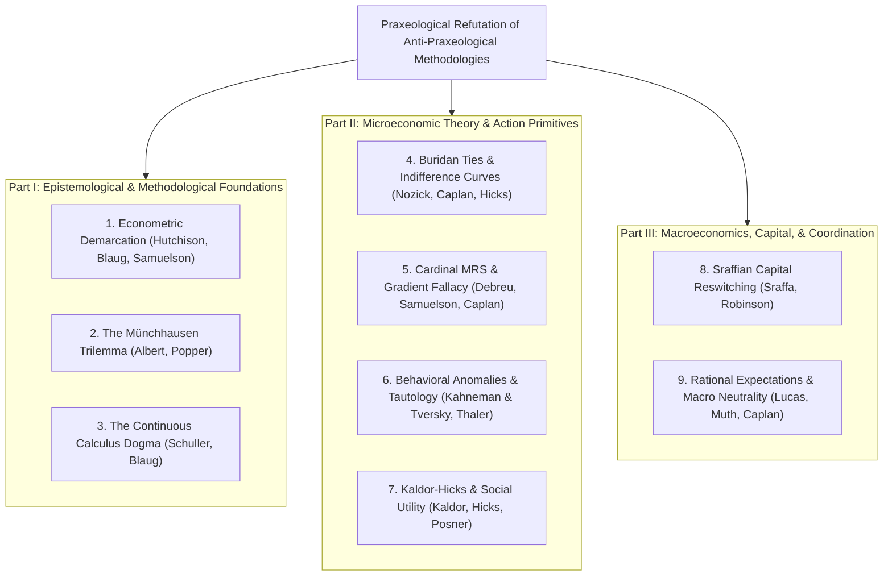

# Praxeological Refutation of Anti-Praxeological Methodologies and Critiques

## Executive Summary

Over the past century, critics adhering to logical positivism, Popperian falsificationism, mathematical formalism, behavioral psychology, Sraffian capital theory, and neoclassical equilibrium modeling have mounted nine foundational challenges against praxeology. 

These challenges target the epistemology, axiomatic foundation, choice apparatus, and macro-structural theorems of human action. Far from undermining praxeology, constructive formalization demonstrates that each challenge either commits a mathematical category error, relies on unphysical assumptions (such as continuous utility manifolds, circular time, or scalar capital aggregations), or collapses into performative self-contradiction.

---

## Contents

- [Executive Summary](#executive-summary)
- [Index of Anti-Praxeological Challenges](#index-of-anti-praxeological-challenges)
- [Part I: Epistemological & Methodological Foundations](#part-i-epistemological--methodological-foundations)
  - [1. Logical Positivism and Econometric Demarcation](#1-logical-positivism-and-econometric-demarcation)
  - [2. Critical Rationalism and the Münchhausen Trilemma](#2-critical-rationalism-and-the-münchhausen-trilemma)
  - [3. Mathematical Formalism and the Continuous Calculus Dogma](#3-mathematical-formalism-and-the-continuous-calculus-dogma)
- [Part II: Microeconomic Theory & Action Primitives](#part-ii-microeconomic-theory--action-primitives)
  - [4. Indifference Curve Analysis and Buridan's Ties Dilemma](#4-indifference-curve-analysis-and-buridans-ties-dilemma)
  - [5. Real-Valued Utility Representations and the Ordinal MRS Fallacy](#5-real-valued-utility-representations-and-the-ordinal-mrs-fallacy)
  - [6. Behavioral Economics and the Tautology Dilemma](#6-behavioral-economics-and-the-tautology-dilemma)
  - [7. Kaldor-Hicks Efficiency and Potential Pareto Compensation](#7-kaldor-hicks-efficiency-and-potential-pareto-compensation)
- [Part III: Macroeconomics, Capital, & Coordination](#part-iii-macroeconomics-capital--coordination)
  - [8. Sraffian Capital Reswitching and Production Structures](#8-sraffian-capital-reswitching-and-production-structures)
  - [9. Rational Expectations and Macro-Intertemporal Neutrality](#9-rational-expectations-and-macro-intertemporal-neutrality)
- [Master Comparison Matrix: Orthodox Critiques vs. Praxeological Realities](#master-comparison-matrix-orthodox-critiques-vs-praxeological-realities)
- [Conclusion](#conclusion)

---

# Part I: Epistemological & Methodological Foundations

## 1. Logical Positivism and Econometric Demarcation

### Target Doctrine & Historical Claims (Hutchison, Blaug, Samuelson)
Originating in the Vienna Circle and popularized in economics by Terence Hutchison (1938), Mark Blaug (1980), and Paul Samuelson (1947), the positivist demarcation criterion demands that every proposition claiming empirical scientific validity must be subject to empirical falsification via observational data. 

Under this doctrine, economic laws must be formulated as quantitative statistical hypotheses testable through econometric regression models. Praxeology’s deduction of apodictic economic theorems from the self-evident Action Axiom is dismissed as unscientific scholasticism, armchair metaphysics, or unempirical dogma.

### Formal Specification
Let moments $\mathcal{T}$ be ordered by strict precedence $\prec$ with backward linearity, branching into maximal histories $\mathcal{H}$ in an action frame (Chapter 2, [Axiom 2.1](../natural_language/02_time_histories_and_physical_execution.md#axiom-21-strict-temporal-precedence)). An empirical econometric dataset is strictly confined to the single realized historical path $h \in \mathcal{H}$:

$$
\mathcal{O}_{\text{hist}}(h) = \{(t, \alpha_t, \omega_t) \mid t \in h\}
$$

Counterfactual branches $`h' \in \mathcal{H} \setminus \{h\}`$ associated with unchosen feasible alternatives $`\beta \in \mathcal{A}_{\text{feas}} \setminus \{\alpha^{\ast}\}`$ leave zero physical or statistical record.

### Proposition 1 (The Econometric Non-Identifiability Theorem)
Because human action continuously branches historical time, any empirical dataset $`\mathcal{O}_{\text{hist}}(h)`$ records exclusively the single realized path. Distinct structural models that coincide along $h$ but specify contradictory unchosen counterfactual rankings on $h' \neq h$ produce identical econometric observations. Consequently, causal behavioral laws cannot be identified from econometric data alone without unprovable *a priori* restrictions. Furthermore, the positivist demarcation criterion is performatively self-refuting.

**Proof.**
1. By Chapter 14 ([Proposition 14.1](../natural_language/14_historical_observation_and_identification.md#proposition-141-non-identification-from-equal-records) and [Theorem 14.3](../natural_language/14_historical_observation_and_identification.md#theorem-143-the-praxeological-lucas-policy-invariance-theorem)), human action branches time: at moment $t$, an agent selects an undominated action $`\alpha^{\ast} \in \mathcal{A}_{\text{feas}}`$, actualizing history branch $h \in \pi_i(t, \alpha^{\ast})$.
2. The agent's choice depends strictly on the counterfactual ranking: $\text{End}(i, \alpha^{\ast}, t, h) \succ_{i,t,h} \text{End}(i, \beta, t, h)$ for all unchosen alternatives $\beta \neq \alpha^{\ast}$.
3. Econometric data records strictly the realized sequence $`\mathcal{O}_{\text{hist}}(h)`$. Counterfactual branches $h'$ associated with unchosen $\beta$ leave zero physical trace.
4. Let $M_1$ and $M_2$ be two structural behavioral models that predict identical choices along $h$ but contradictory rankings on unchosen alternatives $\beta$. Both models generate the exact same likelihood on all observable data: $`\mathcal{L}(M_1 \mid \mathcal{O}_{\text{hist}}) = \mathcal{L}(M_2 \mid \mathcal{O}_{\text{hist}})`$. Hence, observational data cannot identify the true causal structure ([Theorem 14.7](../natural_language/14_historical_observation_and_identification.md#theorem-147-the-duhem-quine-econometric-underdetermination-theorem)).
5. The positivist claim that *"only empirically falsifiable propositions are scientifically meaningful"* is itself neither an empirical observation nor a formal logical tautology. By its own standard, logical positivism is unscientific and self-refuting. $\blacksquare$

### Catallactic & Epistemological Implications
Econometrics is economic history, not economic theory. Regressions establish historical correlations across past realized trajectories; they cannot establish invariant causal laws governing unobservable counterfactual choices. Praxeology provides the indispensable axiomatic framework required to interpret historical data without committing identification fallacies.

---

## 2. Critical Rationalism and the Münchhausen Trilemma

### Target Doctrine & Historical Claims (Albert, Popper)
Drawing on the epistemology of Karl Popper, German critical rationalist Hans Albert (1968) formulated the **Münchhausen Trilemma**, asserting that any attempt to establish an absolute epistemological foundation for knowledge must inevitably fail by terminating in one of three unacceptable dead-ends:
1. **Infinite Regress:** Every justifying premise requires a prior premise *ad infinitum*.
2. **Logical Circularity:** The conclusion is smuggled into the justifying premises.
3. **Dogmatic Stoppage:** The chain of justification is artificially halted at an arbitrary, ungrounded axiom (which critics claim is the case for Mises's Action Axiom).

### Formal Specification
Let $\mathcal{P}$ be the set of propositions assertable by human actors. Let $\vdash$ denote formal logical derivation. A foundationalist claim posits an axiom $A_0 \in \mathcal{P}$ such that for any economic theorem $T$, $A_0 \vdash T$, with $A_0$ requiring no external deductive justification.

### Proposition 2 (Performative Self-Refutation of the Denial of Action)
The Action Axiom does not constitute a dogmatic stoppage within the Münchhausen Trilemma. Purposeful human action is a synthetic *a priori* prerequisite of communication and thought itself; any attempt to deny it results in immediate performative self-contradiction.

**Proof.**
1. Let a critic formally state the negative proposition: $\neg \mathsf{Action}$ (*"Human action does not exist, or cannot serve as the axiomatic foundation of economics"*).
2. The articulation, defense, and communication of $\neg \mathsf{Action}$ requires an acting mind who:
   - Experiences a felt unease (dissatisfaction with praxeological epistemology);
   - Consciously envisions a preferred future end (the intellectual refutation of praxeology);
   - Allocates scarce physical means (time, neurobiological energy, vocal cords, keyboards) across an irreversible temporal interval $t \prec t'$ to attain that end;
   - Prunes alternative feasible uses of those scarce means.
3. These behavioral components satisfy all formal primitives of a purposeful act (purposeful choice $\mathsf{P}(i, t, h, \alpha)$, Chapter 1 and Chapter 3, [Definition 3.8](../natural_language/03_preference_purpose_and_opportunity_cost.md#definition-38-purposeful-choice-relative-to-a-relation)).
4. Consequently, the physical enactment of denying human action performatively demonstrates the existence of human action. The proposition $\neg \mathsf{Action}$ is performatively self-refuting: $\text{Assert}(\neg \mathsf{Action}) \implies \mathsf{Action}$.
5. The Action Axiom is not an arbitrary stoppage; it is an undeniable synthetic *a priori* foundation presupposed by all argumentation and scientific inquiry. $\blacksquare$

### Catallactic & Epistemological Implications
Axioms that cannot be meaningfully denied without performative self-contradiction are not dogmas; they are the transcendental conditions of rational thought. Praxeology rests on an epistemological bedrock that critical rationalism can challenge only by inadvertently verifying.

---

## 3. Mathematical Formalism and the Continuous Calculus Dogma

### Target Doctrine & Historical Claims (Schuller, Blaug)
Mainstream formalist critics—such as George J. Schuller (1949) and Mark Blaug (1992)—allege that Austrian verbal deductions conceal unstated mathematical assumptions. Specifically, they assert that fundamental economic theorems like the **Law of Diminishing Marginal Utility (DMU)** and downward-sloping demand curves cannot be derived without assuming smooth, continuous utility manifolds:

$$
U \in C^2(\mathbb{R}^n), \quad \text{with negative definite Hessian: } \mathbf{z}^T \nabla^2 U(\mathbf{x}) \mathbf{z} < 0
$$

They argue that verbal praxeology simply uses clumsy language to approximate continuous multivariable differential calculus.

### Formal Specification
Let means be partitioned into discrete homogeneous units $m \in \mathcal{M}$. Let an actor have a finite set of atomic intended ends $`\mathcal{E} = \{e_0, e_1, \dots, e_n\}`$ strictly ordered by an asymmetric, transitive preference relation $\succ$:

$$
e_0 \succ e_1 \succ e_2 \succ \dots \succ e_n
$$

Each allocation of physical stock $k \in \mathbb{N}$ maps to an attainable subset of ends $`\mathcal{E}_k \subseteq \mathcal{E}`$.

### Proposition 3 (Constructive DMU on Discrete Allocations Without Calculus)
Diminishing marginal utility can be rigorously derived and represented without continuous utility manifolds ($U \in C^2$), continuous derivatives, or negative definite Hessians. In constructive praxeology, DMU is a theorem of discrete economizing on finite ranked-use structures.

**Proof.**
1. In Chapter 4 ([Theorem 4.13](../natural_language/04_marginal_allocation_and_imputation.md#theorem-413-the-law-of-diminishing-marginal-utility) and [Proposition 4.14](../natural_language/04_marginal_allocation_and_imputation.md#proposition-414-purposeful-allocation-recovers-ranked-prefix-sets)), an actor possesses homogeneous means units. Each unit satisfies an atomic end requiring exactly one unit of physical input.
2. Given a stock of $k$ units, an economizing actor purposefully chooses the subset allocation that attains the most preferred ends. Under strict ordinal ranking, the unique undominated subset is the top-$k$ ranked prefix: $`\mathcal{E}_k = \{e_0, e_1, \dots, e_{k-1}\}`$.
3. When endowed with an additional unit ($k+1$), the newly attainable end is strictly $e_k$.
4. By preference asymmetry and derived irreflexivity (Chapter 3, [Axiom 3.3](../natural_language/03_preference_purpose_and_opportunity_cost.md#axiom-33-strict-asymmetry-of-preference) and [Proposition 3.4](../natural_language/03_preference_purpose_and_opportunity_cost.md#proposition-34-derived-strict-irreflexivity-of-preference)), $e_k$ is strictly lower-ranked than all previously attained ends:
   
$$
\forall j < k, \quad e_j \succ e_k
$$

5. Conversely, if one unit of stock is surrendered, an economizing actor surrenders the least urgent fulfilled end, which is precisely $e_{k-1}$ (least-urgent end selection in a finite ordered set, Chapter 3, [Lemma 3.23](../natural_language/03_preference_purpose_and_opportunity_cost.md#lemma-323-existence-of-least-urgent-ends-in-finite-posets)).
6. In Chapter 4 (Section 4.4, [Proposition 4.14](../natural_language/04_marginal_allocation_and_imputation.md#proposition-414-purposeful-allocation-recovers-ranked-prefix-sets)), this discrete ordinal ranking is formalized in an action frame endowed with discrete allocation menus. The derivation is exact, fully discrete, and uses zero calculus derivatives or Hessian determinants. $\blacksquare$

### Catallactic & Epistemological Implications
Continuous calculus manifolds in consumer theory are an unphysical mathematical fiction. Human goods are discrete physical quanta; human ends are discrete ordinal rankings. Praxeology’s discrete derivation does not "conceal" calculus—it corrects the unphysical continuum assumptions of mathematical formalism.

---

# Part II: Microeconomic Theory & Action Primitives

## 4. Indifference Curve Analysis and Buridan's Ties Dilemma

### Target Doctrine & Historical Claims (Nozick, Caplan, Hicks)
Neoclassical microeconomics builds consumer choice upon continuous **indifference curves** (Edgeworth 1881, Hicks & Allen 1934). Critics such as Robert Nozick (1977) and Bryan Caplan (1999) assert that praxeology’s rejection of indifference creates an insurmountable logical dilemma:
- If an agent faces two physically symmetric alternatives (e.g., Buridan's ass situated equidistant between two identical bales of hay), an agent lacking an indifference relation must suffer infinite paralysis and starve.
- If the agent chooses either bale, they have engaged in choice between items between which they were psychically indifferent, proving that indifference is an operational economic category.

> [!TIP]
> For an exhaustive mathematical analysis of electronic arbiters, physical metastability, and teleological choice under symmetry, see the dedicated treatise: [`critiques/buridans_principle.md`](buridans_principle.md). For the foundational critique of continuous indifference manifolds, see [`critiques/indifference_curve_analysis.md`](indifference_curve_analysis.md).

### Formal Specification
Let an agent at decision index $\langle t, h \rangle$ face feasible menu $`\mathcal{A}_{\text{feas}} = \{\alpha_A, \alpha_B, \alpha_0\}`$, where $\alpha_A$ and $\alpha_B$ are two symmetric courses of action (eating Hay $A$ vs. Hay $B$), and $\alpha_0$ represents inaction (starvation).

### Proposition 4 (Resolution of Buridan Ties via Undominated Choice)
Rejecting neoclassical indifference curves does not lead to Buridan paralysis. Purposeful action requires selecting an undominated action from the feasible menu (existence of an undominated end in finite choice menus, Chapter 3, [Lemma 3.22](../natural_language/03_preference_purpose_and_opportunity_cost.md#lemma-322-existence-of-undominated-elements-in-finite-posets)), which terminates choice in a single finite transition step ($t \prec t'$) without requiring an indifference relation.

**Proof.**
1. In neoclassical economics, choice requires scalar maximization: an agent can choose between $A$ and $B$ only if $U(A) > U(B)$ or $U(A) = U(B)$ (indifference).
2. In praxeology (Chapter 3, [Definitions 3.8](../natural_language/03_preference_purpose_and_opportunity_cost.md#definition-38-purposeful-choice-relative-to-a-relation)–[3.9](../natural_language/03_preference_purpose_and_opportunity_cost.md#definition-39-purposeful-choice-under-the-agents-preference)), purposeful action requires selecting an undominated option from $`\mathcal{A}_{\text{feas}}`$:
   
$$
\alpha^{\ast} \in \text{Undominated}(\mathcal{A}_{\text{feas}}) \iff \forall \beta \in \mathcal{A}_{\text{feas}}, \quad \neg (\text{End}(\beta) \succ \text{End}(\alpha^{\ast}))
$$

3. Both active choices strictly dominate inaction: $\text{End}(\alpha_A) \succ \text{End}(\alpha_0)$ and $\text{End}(\alpha_B) \succ \text{End}(\alpha_0)$.
4. Under symmetry, neither active option dominates the other: $\neg(e_A \succ e_B) \wedge \neg(e_B \succ e_A)$.
5. The undominated choice set is non-empty: $`\text{Undominated}(\mathcal{A}_{\text{feas}}) = \{\alpha_A, \alpha_B\}`$.
6. Selecting either $\alpha_A$ or $\alpha_B$ terminates the decision node in a single transition step ($t \prec t'$), satisfying purposeful action. Demonstrated preference proves that eating strictly dominated starvation ($\alpha_0$); it does not demonstrate mathematical indifference between $A$ and $B$. $\blacksquare$

### Catallactic & Epistemological Implications
Action demonstrates preference, never indifference. When an actor chooses $A$ over $B$, they have chosen $A$. If an actor is genuinely indifferent between two outcomes, they do not act between them; they act on whatever margin breaks the symmetry. Indifference is an unobservable psychological state, not an economic category.

---

## 5. Real-Valued Utility Representations and the Ordinal MRS Fallacy

### Target Doctrine & Historical Claims (Debreu, Samuelson, Caplan)
Neoclassical microeconomics argues that real-valued utility functions $U: \mathbb{R}^n \to \mathbb{R}$ are strictly ordinal because any strictly monotonic transformation $F(U)$ with $F' > 0$ preserves the preference ordering. 

Bryan Caplan (1999) argues that because the **Marginal Rate of Substitution (MRS)** is strictly invariant under monotonic transformations:

$$
MRS = \frac{\partial (F \circ U) / \partial x_1}{\partial (F \circ U) / \partial x_2} = \frac{F'(U) \cdot U_1}{F'(U) \cdot U_2} = \frac{U_1}{U_2} = \frac{P_1}{P_2}
$$

the ratio of marginal utilities is an ordinal property, refuting Murray Rothbard's objection that ordinal rankings cannot be divided, added, or multiplied.

### Formal Specification
Let commodities $m \in \mathcal{M}$ be discrete goods. In consumer equilibrium, neoclassical theory equates the gradient ratio of a continuous utility function to the market price ratio: $\nabla U(\mathbf{x}) \parallel \mathbf{P}$.

### Proposition 5 (Incommensurability of Utility Gradients on Discrete Antichains)
Physical means are discrete, heterogeneous quanta forming antichains that lack topological connectedness. Continuous partial derivatives $\partial U / \partial x_i$ do not exist on discrete action frames. Equating the Marginal Rate of Substitution to market price ratios conflates an individual's subjective ordinal valuation with an objective cardinal exchange ratio established at the margin of bilateral market clearing.

**Proof.**
1. By Chapter 9 ([Definition 9.24](../natural_language/09_money_prices_and_calculation.md#definition-924-physical-input-order-and-antichains), [Proposition 9.25](../natural_language/09_money_prices_and_calculation.md#proposition-925-physical-incomparability)), physical goods form discrete posets with antichains ($m_1 \not\le m_2$ and $m_2 \not\le m_1$). Discrete physical goods lack the topological connectedness of $\mathbb{R}^n$.
2. In Chapter 9 ([Theorem 9.32](../natural_language/09_money_prices_and_calculation.md#theorem-932-the-mises-hayek-economic-calculation-impossibility-theorem)), it is proven that physical antichains cannot be projected onto scalar metrics without order-reversal anomalies under order-preserving scalings.
3. The limit definition of the partial derivative:
   
$$
\frac{\partial U}{\partial x_i} = \lim_{\Delta x_i \to 0} \frac{U(x_i + \Delta x_i, \mathbf{x}_{-i}) - U(x_i, \mathbf{x}_{-i})}{\Delta x_i}
$$

   requires infinitesimal physical variations along one coordinate while holding others fixed. In physical reality, economic goods exist in discrete indivisible units; infinitesimal variations $\Delta x_i \to 0$ are physically infeasible.
4. The equation $U_1 / U_2 = P_1 / P_2$ equates a subjective ratio to an objective monetary price ratio. By Chapter 9 ([Theorem 9.15](../natural_language/09_money_prices_and_calculation.md#theorem-915-the-böhm-bawerk-discrete-marginal-pair-bracket-theorem)), market prices $P_1, P_2$ are not determined by an isolated individual's internal utility derivatives; they are established at the intersection of conflicting reservation bids across distinct buyers and sellers.
5. Ranks cannot be divided. Transforming an ordinal ranking into a continuous gradient is a mathematical convenience that misrepresents the discrete, branching nature of purposeful choice. $\blacksquare$

### Catallactic & Epistemological Implications
Ordinal numbers designate position (1st, 2nd, 3rd); they cannot be subjected to arithmetic operations. Dividing the 1st preference by the 2nd preference yields nonsense. Equating $MRS$ to $P_1/P_2$ smuggles cardinal utility into neoclassical consumer theory under the guise of ordinalism.

---

## 6. Behavioral Economics and the Tautology Dilemma

### Target Doctrine & Historical Claims (Kahneman & Tversky, Thaler)
Behavioral economists (Daniel Kahneman, Amos Tversky, Richard Thaler) have documented widespread cognitive heuristics—including framing effects, loss aversion, status quo bias, and hyperbolic discounting (present bias). 

Critics use these findings to construct a dilemma against praxeology:
- **Horn 1 (Empirical Refutation):** If the Action Axiom asserts that human beings are cognitively rational, utility-maximizing calculators, empirical psychology has conclusively refuted it.
- **Horn 2 (Empty Tautology):** If praxeology defines "action" so broadly that any observed behavior (including framing anomalies and addiction) is classified as "purposeful," the Action Axiom is an unfalsifiable linguistic tautology with zero empirical content.

> [!TIP]
> For a comprehensive formalization of framing effects, bounded contemplation, and paternalistic menu-stripping, see the dedicated treatise: [`critiques/behavioral_economics.md`](behavioral_economics.md).

### Formal Specification
Let $\mathcal{C}$ be the set of contextual decision frames. An agent's subjective preference is indexed to decision context $c \in \mathcal{C}$ at decision node $\langle t, h \rangle$: $\succ_{i, t, h, c}$.

### Proposition 6 (Teleological Rationality under Contextual Framing)
Behavioral framing effects and dynamic inconsistency do not refute the Action Axiom. Praxeological rationality denotes purposeful striving to relieve felt unease within finite contemplated menus, not cognitive omniscience. Furthermore, dynamic inconsistency explains the teleological market demand for commitment devices.

**Proof.**
1. By Chapter 3 and Chapter 5, purposeful action requires allocating scarce means toward subjectively chosen ends. Praxeological rationality does not mean omniscience or mathematical optimization; it means purposeful striving to relieve felt unease.
2. Behavioral framing effects index an agent's preference poset to decision context $c \in \mathcal{C}$: $\succ_{i, t, h, c}$. An agent choosing under Frame 1 may rank $e_1 \succ e_2$, while under Frame 2 ranking $e_2 \succ e_1$. Each choice is purposeful within its specific historical moment.
3. Present bias and hyperbolic discounting do not contradict praxeology: an agent acts purposefully at the planning moment ($t_0$), acts purposefully at the temptation moment ($t_1$), and experiences retrospective regret at the evaluation moment ($t_2$) along branching historical time (Chapter 5).
4. The observed market demand for commitment devices $\alpha_{\text{commit}}$ (e.g., contractual penalties, illiquid savings) proves that agents purposefully anticipate dynamic inconsistency and prune future feasible menus ( $`\mathcal{A}_{\text{feas}}(t') \subsetneq \mathcal{A}_{\text{feas}}(t)`$ ) to bind their future actions. Far from refuting action, behavioral heuristics demonstrate teleological economizing in branching time. $\blacksquare$

### Catallactic & Epistemological Implications
The behavioral economics critique attacks a neoclassical strawman (Homo Economicus). Praxeology never posited a hyper-rational, mathematically calculating automaton; it posited human actors acting under uncertainty, bounded contemplation, and evolving subjective desires.

---

## 7. Kaldor-Hicks Efficiency and Potential Pareto Compensation

### Target Doctrine & Historical Claims (Kaldor, Hicks, Posner, Caplan)
Neoclassical welfare economics recognized that the Pareto unanimity criterion (an allocation is an improvement if and only if at least one person is made better off and no one is made worse off) paralyzes public policy evaluation, because almost every state intervention harms someone.

To circumvent this, Nicholas Kaldor (1939) and John Hicks (1939)—later expanded by Richard Posner (1979)—formulated the **Kaldor-Hicks Compensation Principle**: an economic reallocation is socially efficient if total monetary gains exceed total monetary losses:

$$
\sum_{i \in \mathcal{I}} \Delta W_i > 0
$$

Under this rule, winners could hypothetically compensate losers, even if no compensation is ever paid.

> [!TIP]
> For a rigorous analysis of the Scitovsky reversal paradox, interpersonal utility aggregation, and the political economy of cost-benefit analysis, see the dedicated treatise: [`critiques/kaldor_hicks_efficiency.md`](kaldor_hicks_efficiency.md).

### Formal Specification
Let $\mathcal{I}$ be a finite cohort of distinct economic agents. Let $\Delta W_i \in \mathbb{R}$ represent the nominal monetary wealth change experienced by agent $i$ following a policy intervention.

### Proposition 7 (The Category Error of Kaldor-Hicks Compensation)
Summing monetary gains and losses across distinct individuals treats nominal money tokens as cardinal utility quanta, resurrecting the mathematical category error of interpersonal utility comparison. Hypothetical compensation leaves losers uncompensated, violating demonstrated preference and converting welfare economics into an ideological defense of coercive state extraction.

**Proof.**
1. By Chapter 3 and Chapter 8 ([Theorem 8.24](../natural_language/08_social_interaction_property_and_exchange.md#theorem-824-the-double-inequality-of-voluntary-exchange-theorem)), utility is strictly ordinal and individual ($u_i \not\sim u_j$). There exists no cardinal metric or social welfare aggregator through which the subjective gain of agent $A$ can cancel the subjective loss of agent $B$.
2. Nominal money balances $\Delta W_i$ do not represent utility quanta. By Chapter 4 ([Theorem 4.13](../natural_language/04_marginal_allocation_and_imputation.md#theorem-413-the-law-of-diminishing-marginal-utility)), the marginal utility of a monetary dollar depends entirely on the subjective rank of the marginal end it satisfies on that specific actor's value scale.
3. If compensation is merely hypothetical, losers experience a genuine, uncompensated physical injury. By Chapter 3 (Axiom of Purposefulness), losers demonstrate preference against the policy.
4. Coercively imposing a Kaldor-Hicks reallocation constitutes an act of political hegemony ([Theorem 12.1](../natural_language/12_state_and_fiscal_political_economy.md#theorem-121-the-coercive-invariance-of-public-services-theorem)). Wealth maximization fails as an objective efficiency standard; it is an analytical pretext for coercive property redistribution. $\blacksquare$

### Catallactic & Epistemological Implications
There is no such entity as "society" capable of experiencing utility gains. When the state seizes private property to build a highway, claiming that the "social gains exceed the costs," it has simply enriched some individuals at the expense of others. Only voluntary exchange satisfies demonstrated social efficiency.

---

# Part III: Macroeconomics, Capital, & Coordination

## 8. Sraffian Capital Reswitching and Production Structures

### Target Doctrine & Historical Claims (Sraffa, Robinson)
In the Cambridge Capital Controversy, Piero Sraffa (1960) and Joan Robinson demonstrated the phenomenon of **reswitching of techniques**: as the rate of profit varies, the exact same production technique can be cost-minimizing at a high rate of profit, become unviable at intermediate rates, and then *reswitch* back to being cost-minimizing at a low rate of profit.

Neo-Ricardian economists argued that reswitching completely destroys the concept of "roundaboutness" (Böhm-Bawerk) and proves that production stages cannot be ordered by physical capital intensity or temporal length.

> [!TIP]
> For an exhaustive mathematical derivation of Samuelson's 1966 canonical dated-labor example, switching roots ($r_1 = 50\%, r_2 = 100\%$), wage-profit curves, and factor conservation bounds, see the dedicated treatise: [`critiques/cambridge_capital_controversy.md`](cambridge_capital_controversy.md).

### Formal Specification
Let production techniques be vectors of dated labor inputs. Let $\Delta C(r) = C_B(r) - C_A(r)$ be the unit cost difference between two techniques as a function of the interest rate $r$.

### Proposition 8 (Demystification of Reswitching and Forward Imputation)
Reswitching validly refutes the neoclassical aggregate production function ( $Y = F(K, L)$ ), but does not undermine praxeological capital theory. Reswitching is an elementary mathematical consequence of discounting multi-period expenditure streams with compound interest $(1+r)^t$ (the multiple IRR problem). Production in an action frame (Chapter 2, [Axiom 2.1](../natural_language/02_time_histories_and_physical_execution.md#axiom-21-strict-temporal-precedence)) is strictly unidirectional in historical time, past costs are sterile, and interest is grounded in pure time preference, not physical capital productivity.

**Proof.**
1. In Chapter 9 ([Proposition 9.25](../natural_language/09_money_prices_and_calculation.md#proposition-925-physical-incomparability) and [Theorem 9.32](../natural_language/09_money_prices_and_calculation.md#theorem-932-the-mises-hayek-economic-calculation-impossibility-theorem)), capital goods form heterogeneous antichains. Praxeology never posited an aggregate scalar measure of physical capital ("Jelly Capital"). The Cambridge UK refutation of scalar $K$ is fully endorsed by praxeology.
2. Sraffa's model assumes a timeless, circular production system without money where commodities reproduce themselves via simultaneous linear equations. In actual human action, production is strictly unidirectional across branching historical time ($t_0 \prec t_1 \prec \dots \prec t_n$, Chapter 2). Sunk past labor costs are economically sterile ([Theorem 4.32](../natural_language/04_marginal_allocation_and_imputation.md#theorem-432-the-present-endowment-sunk-cost-sterility-theorem)).
3. In Chapter 7 ([Definition 7.1](../natural_language/07_time_preference_interest_and_capital.md#definition-71-timed-ends) and [Theorem 7.16](../natural_language/07_time_preference_interest_and_capital.md#theorem-716-the-master-positive-time-preference-and-originary-interest-synthesis)), originary interest $\delta \ge 1$ is derived from universal positive time preference across dated ends, not from physical capital surplus.
4. The cost difference $\Delta C(x) = \sum a_t x^t$ (where $x = 1+r$ ) is a polynomial in $x$. By Descartes' Rule of Signs, alternating expenditure profiles across time guarantee multiple positive real roots. Reswitching is mathematically identical to the multiple Internal Rates of Return (IRR) problem in corporate capital budgeting.
5. In Chapter 13 ([Proposition 13.3](../natural_language/13_business_cycles_and_crisis.md#proposition-133-complementary-factor-starvation-blocks-completion) and [Theorem 13.9](../natural_language/13_business_cycles_and_crisis.md#theorem-139-the-austrian-business-cycle-master-theorem)), production is strictly bounded by physical factor scarcity across sequential stages. Reswitching simply reflects non-linear discounting of multi-period cash flows; it does not alter the temporal necessity of roundabout capital advances. $\blacksquare$

### Catallactic & Epistemological Implications
Sraffa dismantled neoclassical aggregate production functions, but Neo-Ricardians committed a category error by conflating Böhm-Bawerk’s early scalar index with the Austrian multidimensional structure of production. Capital is a heterogeneous, complementary lattice whose monetary valuation shifts dynamically with interest rates.

---

## 9. Rational Expectations and Macro Intertemporal Neutrality

### Target Doctrine & Historical Claims (Lucas, Muth, Caplan)
The New Classical / Rational Expectations (RE) critique—originated by John Muth (1961) and Robert Lucas (1972, 1976), and wielded against Austrian Business Cycle Theory by Bryan Caplan (1997)—asserts that if central banks expand credit according to a systematic policy rule, rational forward-looking economic agents will anticipate the resulting price inflation:

$$
E_t[P_{t+k} \mid \Omega_t]
$$

Critics argue that entrepreneurs will factor inflation into loan contracts and hurdle rates, neutralizing relative price distortions. Consequently, predictable monetary expansion allegedly cannot deceive entrepreneurs or cause systemic capital malinvestment clusters.

### Formal Specification
Let the central bank inject unbacked fiduciary media into the economy at decision index $\langle t_0, h \rangle$ through commercial bank advances: $\Delta M_{\mathrm{fid}} > 0$. Let economic information be distributed across localized trading nodes in a network.

### Proposition 9 (Failure of RE Neutrality Under Cantillon Injection Waves)
Rational expectations assumes an ergodic macro state space with uniform price adjustments. In real historical time, fiduciary credit expansion enters circulation through localized institutional injection points (Cantillon waves). Because heterogeneous capital antichains cannot be aggregated, entrepreneurs cannot calculate or hedge the path of relative price distortions. Systemic malinvestment occurs because accounting price signals are objectively falsified.

**Proof.**
1. By Chapter 9 ([Proposition 9.23](../natural_language/09_money_prices_and_calculation.md#proposition-923-cantillon-network-purchasing-power-dilution), Cantillon Network Dilution) and Chapter 10 ([Proposition 10.10](../natural_language/10_entrepreneurship_credit_and_investment.md#proposition-1010-physical-effects-of-note-issuance)), newly manufactured fiduciary credit enters circulation at specific institutional injection nodes (e.g., mortgage banks, primary dealers), not as a uniform, simultaneous helicopter drop.
2. The initial injection bids up specific factor and asset prices long before downstream wages and consumer prices adjust.
3. In Chapter 9 ([Theorem 9.32](../natural_language/09_money_prices_and_calculation.md#theorem-932-the-mises-hayek-economic-calculation-impossibility-theorem)) and Chapter 14 ([Corollary 14.6](../natural_language/14_historical_observation_and_identification.md#corollary-146-macro-aggregates-do-not-identify-the-capital-regime)), capital goods form heterogeneous antichains that cannot be aggregated into a single price index. Even if an entrepreneur anticipates that the aggregate money supply will expand by 5%, that macro figure contains zero information regarding which specific capital goods will experience input cost surges or demand contractions along the branching historical tree (Chapter 14).
4. Competing entrepreneurs cannot unilaterally "refuse" low-interest credit: an entrepreneur who refuses to borrow at subsidized rates is outcompeted by rivals who do.
5. In Chapter 13 ([Theorem 13.9](../natural_language/13_business_cycles_and_crisis.md#theorem-139-the-austrian-business-cycle-master-theorem) and [Theorem 13.12](../natural_language/13_business_cycles_and_crisis.md#theorem-1312-the-fiduciary-factor-starvation-cycle-theorem)), the resulting price-box squeeze and complementary-factor starvation are the objective consequences of distorted monetary accounting, not subjective cognitive irrationality. $\blacksquare$

### Catallactic & Epistemological Implications
Rational expectations assumes that agents possess a true structural model of the economy. But under central bank manipulation, the price system transmits falsified information regarding the availability of real savings. When the yardstick of economic calculation is distorted, rational action within the market generates macroeconomic coordination failure.

---

## Conclusion

The nine foundational challenges to praxeology collapse upon rigorous constructive formalization:
1. Econometric regressions cannot identify unchosen counterfactuals;
2. Purposeful action is an undeniable synthetic *a priori* reality;
3. Diminishing Marginal Utility holds constructively on discrete posets without calculus manifolds;
4. Symmetric choices are resolved via undominated choice without unobservable indifference manifolds;
5. Real-valued utility representations fail on discrete capital antichains;
6. Behavioral heuristics reflect contextual posets and validate teleological commitment devices;
7. Kaldor-Hicks compensation is a mathematical category error;
8. Capital reswitching refutes neoclassical aggregates ( $Y = F(K, L)$ ) while leaving unidirectional, time-preference capital theory intact; and
9. Rational expectations cannot overcome localized Cantillon credit waves and objective price-accounting falsification.

Grounded in the constructive primitives of human action, praxeology stands as the rigorous, apodictic foundation of economic science.
