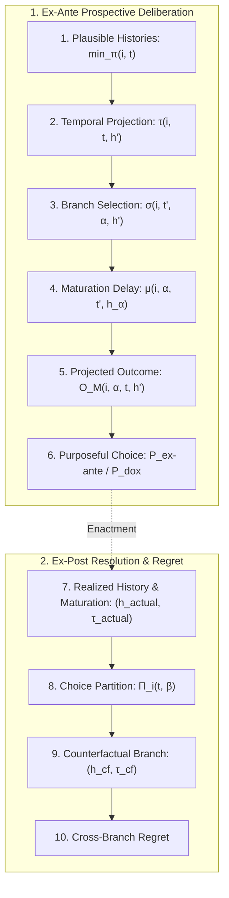

# Chapter 5: Belief, Uncertainty, and Regret

We represent uncertainty by histories and an ordering of their plausibility. This gives us a way to define belief before comparing anticipated outcomes. From there we can distinguish choice before resolution from regret assessed after a branch has occurred.

> **Prerequisites and scope:** Chapters 1–3. We add plausible histories, anticipated outcomes, ex-ante choice, and counterfactual regret. Chapter 6 uses belief alongside knowledge and ability.

---

## Orientation & Conceptual Pipeline

In Chapters 1–4, an action's consequence was evaluated at a single actual node with immediate ends. Under real-world uncertainty, three fundamental gaps emerge:
1. **The Epistemic Gap:** The acting agent does not know which future branch will occur; belief is grounded in an ordering of plausible histories without presupposing cardinal probabilities.
2. **The Temporal & Counterfactual Gap (Maturation Delay):** Actions take time to mature. Evaluating an action requires projecting the decision moment onto a plausible history, selecting a branch that executes the action, and waiting for its physical consequence to mature.
3. **The Appraisal Gap:** Cross-world anticipated outcomes must be bridged to the single ordinal preference ranking $\succ_{i,t,h}$ without resorting to cardinal expected utility.

The decision-and-regret architecture proceeds through the following pipeline:

### Guide to New Symbols and Operators

The table below catalogs the symbols and operators introduced in this chapter:

| Symbol / Operator | Concept | Mathematical Meaning | First Definition |
|---|---|---|---|
| $`\min_{\pi}(i, t) \subseteq \mathcal{H}`$ | Minimal Plausibility Stratum | Nonempty set of histories agent $i$ considers most plausible at moment $t$. | [Definition 5.1](#definition-51-minimal-plausibility-strata-and-belief) |
| $B_i^t \psi$ | Doxastic Belief Operator | Belief that proposition $\psi$ holds across all minimally plausible histories. | [Definition 5.1](#definition-51-minimal-plausibility-strata-and-belief) |
| $`\le_{\mathbf{P}}`$ on $\mathcal{H}$ | Plausibility Preorder | Total preorder ranking candidate histories by comparative plausibility. | [Definition 5.2](#definition-52-a-total-preorder-of-plausibility) |
| $`\mathbf{P} \Uparrow \psi`$ | Lexicographic Signal Upgrade | Belief revision updating $\mathbf{P}$ upon observing signal $\psi$ without collapse. | [Definition 5.4](#definition-54-lexicographic-signal-upgrade) |
| $`\tau(i, t, h')`$ | Temporal Projection Map | Locates the decision moment on plausible history $h'$ corresponding to $t$. | [Definition 5.7](#definition-57-projected-ex-ante-outcome) |
| $`\sigma(i, t', \alpha, h')`$ | Branch Selection Map | Selects a counterfactual history $h_\alpha$ through $t'$ where alternative $\alpha$ is enacted. | [Definition 5.7](#definition-57-projected-ex-ante-outcome) |
| $`\mu(i, \alpha, t', h_\alpha)`$ / $\text{mature}$ | Maturation Moment Map | Future moment on $h_\alpha$ at which the consequence of $\alpha$ matures ($t' \preceq \mu$). | [Definition 5.7](#definition-57-projected-ex-ante-outcome) |
| $\text{maturedOutcome}$ | Matured Physical Outcome | The ex-post physical/teleological outcome realized at the maturation moment. | [Definition 5.7](#definition-57-projected-ex-ante-outcome) |
| $`\widehat{O}_M(i, \alpha, t, h')`$ / $M$ | Projected Ex-Ante Outcome | Composite outcome operator $\text{maturedOutcome}(\dots, \mu(\dots), \sigma(\dots))$. | [Definition 5.7](#definition-57-projected-ex-ante-outcome) |
| $`\text{UA}(i, t, h, \alpha)`$ | Uniform Availability | Action $\alpha$ is feasible at $(i, t, h)$ and at all projected nodes $\tau(i, t, h')$. | [Definition 5.7](#definition-57-projected-ex-ante-outcome) |
| $`\mathcal{A}_{\text{rob}}(i, t, h)`$ | Robust Menu | Feasible actions uniformly available across all minimally plausible projected nodes. | [Definition 5.7](#definition-57-projected-ex-ante-outcome) |
| $`\mathcal{F}_{\mathrm{branch},M}(i, t, H_t, \alpha_0)`$ | Inaction Branch Feasibility | Certifies that history bundle $H_t$ contains a branch where the agent refrains. | [Definition 5.9](#definition-59-doxastic-purposeful-action-in-the-maturation-model) |
| $`\mathsf{P}_{\mathrm{ex\text{-}ante},M}(i, t, h, \alpha^{\ast})`$ | Ex-Ante Purposeful Action | Action undominated by robust rivals across all minimally plausible histories. | [Definition 5.8](#definition-58-ex-ante-purposeful-action) |
| $`\mathsf{P}_{\mathrm{dox},M}(i, t, H_t, h)`$ | Doxastic Purposeful Action | Action undominated by locally feasible rivals relative to history bundle $H_t$. | [Definition 5.9](#definition-59-doxastic-purposeful-action-in-the-maturation-model) |
| $`\Pi_i(t, \beta)`$ | Choice Partition Cell | The set of histories through $t$ on which action $\beta$ is enacted. | [Definition 5.10](#definition-510-choice-partition-in-the-maturation-model) |
| $h_{\text{actual}}, \tau_{\text{actual}}$ vs. $h_{\text{cf}}, \tau_{\text{cf}}$ | Regret Comparison Branches | Actual realized path and maturation vs. counterfactual path and maturation. | [Definition 5.11](#definition-511-cross-branch-counterfactual-regret) |

---

We first specify which histories an agent considers most plausible. That set supports belief, but it does not yet tell us what an action is expected to produce. We therefore add a projection from each plausible history to an action branch and a time of maturation before defining ex-ante choice and regret.

## Belief and Plausibility Ordering

To reason about uncertainty, we need both a set of candidate histories and a way to rank them. We begin with the histories tied for greatest plausibility. Then we introduce a preorder so that an unexpected signal can be incorporated without leaving the model with no minimally plausible history.

### Definition 5.1 (Minimal Plausibility Strata and Belief)
For each agent and moment, let the minimal plausibility set be

$$
\min_{\pi}(i, t) \subseteq \mathcal{H}
$$

satisfying the nonemptiness condition

$$
(\min_{\pi}(i, t)).\text{Nonempty}
$$

We say the agent believes a proposition $\psi$ at $t$ when it holds on every history in that set:

$$
B_i^t \psi \iff \forall h' \in \min_{\pi}(i, t), \quad \psi(h')
$$

A plausible history need not contain the actual moment $t$. We will therefore use a projection to locate the relevant decision moment on each such history. If the history already contains $t$, the projection returns $t$; otherwise it identifies the moment the agent treats as corresponding to $t$.

### Updating Beliefs after a Signal
The simplest update keeps only histories in the prior minimal set that satisfy the observed signal $\varepsilon$:

$$
\text{DELUpdate}(i, t, \varepsilon) \equiv \min_{\pi}(i, t) \cap \varepsilon
$$

This filtering rule can return the empty set if the signal conflicts with every prior minimum. An empty set would make every universally quantified belief vacuously true. To avoid that result, we next rank all histories, not only the prior minima, so that a new signal can promote compatible histories when they exist and preserve the prior ranking when none do.

### Definition 5.2 (A Total Preorder of Plausibility)
We rank histories by a reflexive, transitive, total relation $\le$, where $h_1\le h_2$ means that $h_1$ is at least as plausible as $h_2$:
1. **Reflexivity**: $\forall h, h \le h$.
2. **Transitivity**: $\forall h_1, h_2, h_3, h_1 \le h_2 \wedge h_2 \le h_3 \implies h_1 \le h_3$.
3. **Totality**: $\forall h_1, h_2, h_1 \le h_2 \vee h_2 \le h_1$.

The **minimal plausible stratum** of a non-empty subset $S \subseteq \mathcal{H}$ under preorder $\mathbf{P}$ is:

$$
\min_{\pi}(\mathbf{P}, S) \equiv \{ h \in S \mid \forall h' \in S, h \le h' \}
$$

### Theorem 5.3 (A Finite Ranked Set Has a Minimal Stratum)
Let $\mathbf{P}$ be a total plausibility preorder with decidable comparison. Given an explicit nonempty list whose members are exactly the histories in $S \subseteq \mathcal{H}$, the minimal plausible stratum is nonempty:

$$
\text{Enumerates}(x :: xs, S) \implies (\min_{\pi}(\mathbf{P}, S)).\text{Nonempty}
$$

**Proof.** Compare the head against the recursively selected minimum of the tail. Decidability supplies the comparison, totality supplies the reverse comparison when needed, and transitivity establishes minimality for every member of the list. The enumeration certificate transfers that conclusion to all of $S$. $\blacksquare$

### Definition 5.4 (Lexicographic Signal Upgrade)
When the agent observes a signal $\psi$, we define a new ordering $\mathbf{P}\Uparrow\psi$ that places signal-compatible histories ahead of incompatible ones while preserving the old ranking within each group:

$$
h_1 \le_{\mathbf{P} \Uparrow \psi} h_2 \iff (h_1 \in \psi \wedge h_2 \notin \psi) \vee ((h_1 \in \psi \iff h_2 \in \psi) \wedge h_1 \le_{\mathbf{P}} h_2)
$$

Thus the signal determines the first comparison; the prior preorder settles comparisons between histories that either both satisfy the signal or both fail it.

### Theorem 5.5 (Effect of the Signal on the Minimal Stratum)
Let $S$ be the histories under consideration. The update has two cases:
1. If no history in $S$ satisfies the signal, the minimal stratum is unchanged:

$$
S \cap \psi = \emptyset \implies \min_{\pi}(\mathbf{P} \Uparrow \psi, S) = \min_{\pi}(\mathbf{P}, S)
$$

2. If some history in $S$ satisfies the signal, the new minimal stratum is the old minimal stratum restricted to those histories:

$$
(S \cap \psi).\text{Nonempty} \implies \min_{\pi}(\mathbf{P} \Uparrow \psi, S) = \min_{\pi}(\mathbf{P}, S \cap \psi)
$$

**Proof.**
1. For any $h, h' \in S$, since $S \cap \psi = \emptyset$, neither $h$ nor $h'$ belongs to $\psi$. Thus the equivalence $h \in \psi \iff h' \in \psi$ holds trivially (both are false). By [Definition 5.4](#definition-54-lexicographic-signal-upgrade), $h \le_{\mathbf{P} \Uparrow \psi} h' \iff h \le_{\mathbf{P}} h'$, which implies equality of the minimal strata.
2. If $h \in \min_{\pi}(\mathbf{P} \Uparrow \psi, S)$, then $h$ must belong to $\psi$; otherwise, any element $w \in S \cap \psi$ would satisfy $w \le_{\mathbf{P} \Uparrow \psi} h$ and $\neg(h \le_{\mathbf{P} \Uparrow \psi} w)$, contradicting minimality of $h$. Since both $h, h' \in S \cap \psi$, the ordering coincides with $\mathbf{P}$, establishing equivalence with $\min_{\pi}(\mathbf{P}, S \cap \psi)$. $\blacksquare$

---

## Maturation, Expected Outcomes, and Ex-Ante Choice

The earlier chapters supplied intended ends, feasible menus, and enacted actions. We now distinguish an intended end from the outcome an action would produce on a possible history. This distinction matters because an agent chooses before the future branch is known, while regret compares outcomes after branches can be distinguished.

### Definition 5.6 (Maturation Model)
A **maturation model** specifies agents, moments, histories, actions, and ends, together with temporal precedence, history incidence, feasible and contemplated actions, enacted actions, plausible histories, preferences, and a passive action. It also specifies three maps: a projection from a decision situation and a plausible history to a decision moment; a selection of a history on which a contemplated action is enacted; and a maturation moment at which that action's result is evaluated.

Every feasible action is contemplated, and the passive action is both feasible and contemplated. A projected decision moment lies on the history used for evaluation. The selected counterfactual history passes through that moment and enacts the action being evaluated. Its maturation moment lies on the same history and is either the decision moment itself or later on that history. These conditions ensure that each projected outcome refers to a well-defined history and time.

### Definition 5.7 (Projected Ex-Ante Outcome)
For action $\alpha$ and plausible history $h'$, define the projected decision moment $t' = \tau(i,t,h')$, selected execution branch $h_\alpha = \sigma(i,t',\alpha,h')$, and maturation moment $\mu(i,\alpha,t',h_\alpha) \equiv \text{mature}(i,\alpha,t',h_\alpha)$. The **projected ex-ante outcome** $\widehat O_M(i,\alpha,t,h')$ (also denoted $M(i,\alpha,t,h')$ ) is:

$$
\begin{aligned}
t'&=\tau(i,t,h'),\qquad h_\alpha=\sigma(i,t',\alpha,h'),\\
\widehat O_M(i,\alpha,t,h') \equiv M(i,\alpha,t,h')&=\text{maturedOutcome}\bigl(i,\alpha,t',
\mu(i,\alpha,t',h_\alpha),h_\alpha\bigr).
\end{aligned}
$$

The expression evaluates one selected history for each plausible history. It describes that selected outcome; it does not say that the action succeeds on every history in its choice cell.

### Strict Causal Futurity from Active Choice

If an active action is purposeful, remains feasible at every minimally plausible projected node, and outcomes are grounded in physical endowments, then at least one minimally plausible history has a strictly later maturation time for either the chosen action or inaction. At the projected node $\tau(i,t,h')$, the conclusion is

$$
\begin{aligned}
\exists h'\in\min_{\pi}(i,t),\quad
&\tau(i,t,h')\prec\mu(i,\alpha^{\ast},\tau(i,t,h'),\sigma(i,\tau(i,t,h'),\alpha^{\ast},h'))\\
&\vee\ \tau(i,t,h')\prec\mu(i,\alpha_0,\tau(i,t,h'),\sigma(i,\tau(i,t,h'),\alpha_0,h')).
\end{aligned}
$$

Evaluating choices across the plausible set requires uniform availability: the chosen action must be feasible at every projected node. Because histories through a projected node share identical present endowments, if neither alternative matured strictly later, their grounded bundles would coincide, precluding any strict preference comparison to justify active choice. Causal futurity is thus derived directly from physical grounding and deliberative choice, establishing that every purposeful action necessarily projects into the future.

An action is **uniformly available** when

$$
\begin{aligned}
\text{UA}(i,t,h,\alpha)\iff{}&\alpha\in A_{\mathrm{feas}}(i,t,h)\\
&\wedge\forall h'\in\min_{\pi}(i,t),\quad
\alpha\in A_{\mathrm{feas}}(i,\tau(i,t,h'),h').
\end{aligned}
$$

The **robust menu** is the set of structurally feasible actions that satisfy uniform availability. Uniform availability is stronger than feasibility at the actual decision node: it requires the action to remain feasible at every projected plausible node. The incidence and selection conditions then ensure that each such evaluation uses a history through the projected node on which the action is enacted, with maturation at or after that node.

A separate **feasibility-transport condition** says that every action feasible at the actual node remains feasible at each projected plausible node. This condition is stronger than the uniform availability of one specified action and is used only when a theorem requires it.

### Definition 5.8 (Ex-Ante Purposeful Action)
An action is **ex-ante purposeful** when it is contemplated, uniformly available, validly executed, strictly preferred to inaction throughout the plausible set, and not uniformly dominated by a robustly available rival:

$$
\begin{aligned}
\mathsf{P}_{\mathrm{ex\text{-}ante},M}(i,t,h,\alpha^{\ast})\iff{}&
\alpha^{\ast}\in A_{\mathrm{cont}}(i,t,h)\ \wedge\ \text{UA}(i,t,h,\alpha^{\ast})\\
&\wedge\ t\in h\ \wedge\ \text{enacted}(i,t,h)=\alpha^{\ast}\\
&\wedge\forall h'\in\min_{\pi}(i,t),\quad
\widehat O_M(i,\alpha^{\ast},t,h')\succ_{i,t,h}\widehat O_M(i,\alpha_0,t,h')\\
&\wedge\forall\beta\in\mathcal{A}_{\mathrm{rob}}(i,t,h),\quad
\neg\bigl(\forall h'\in\min_{\pi}(i,t),\
\widehat O_M(i,\beta,t,h')\succ_{i,t,h}\widehat O_M(i,\alpha^{\ast},t,h')\bigr).
\end{aligned}
$$

The rival clause permits trade-offs across plausible histories: a rival excludes an action only when it strictly improves outcomes across every plausible branch. The strict comparison with inaction requires the chosen act to actively improve upon passivity, distinguishing subjective purpose from objective know-how (which [Chapter 6](06_knowledge_ability_and_communication.md#chapter-6-knowledge-ability-and-communication) formalizes separately).

We also require a concept of purposefulness that records which historical bundle is under deliberative consideration and explicitly requires inaction to be realized on an alternative branch in that bundle. This ensures that refraining is a genuine counterfactual alternative.

### Definition 5.9 (Doxastic Purposeful Action in the Maturation Model)
An enacted action is **doxastically purposeful** relative to history bundle $H_t$ when the actual history belongs to $H_t$, both the enacted action and passive inaction $\alpha_0$ are feasible at $(i,t,h)$, inaction is branch-feasible within $H_t$, minimal plausibility is nonempty, the enacted action strictly relieves felt unease over inaction across every minimally plausible history, and no feasible rival unanimously dominates it:

$$
\begin{aligned}
\mathsf{P}_{\mathrm{dox},M}(i,t,H_t,h)\iff{}&h\in H_t\ \wedge\ \text{enacted}(i,t,h)\in A_{\mathrm{feas}}(i,t,h)\ \wedge\ \alpha_0\in A_{\mathrm{feas}}(i,t,h)\\
&\wedge\ \mathcal{F}_{\mathrm{branch},M}(i,t,H_t,\alpha_0)\ \wedge\ (\min_{\pi}(i,t)\ne\emptyset)\\
&\wedge\forall h'\in\min_{\pi}(i,t),\quad
\widehat O_M(i,\text{enacted}(i,t,h),t,h')\succ_{i,t,h}\widehat O_M(i,\alpha_0,t,h')\\
&\wedge\forall\beta\in A_{\mathrm{feas}}(i,t,h),\quad
\neg\bigl(\forall h'\in\min_{\pi}(i,t),\
\widehat O_M(i,\beta,t,h')\succ_{i,t,h}\widehat O_M(i,\text{enacted}(i,t,h),t,h')\bigr).
\end{aligned}
$$

This definition grounds belief-dependent purposeful choice in five structural elements: bundle membership, local feasibility of action and inaction, a genuine branch on which the agent refrains, non-vacuous plausibility, and strict improvement over inaction combined with undominatedness against all feasible rivals $`A_{\mathrm{feas}}(i,t,h)`$. It differs from ex-ante purposefulness ( $`\mathsf{P}_{\mathrm{ex\text{-}ante},M}`$ ) in that rivals are not restricted to the robust menu $`\mathcal{A}_{\mathrm{rob}}`$, and uniform availability across projected nodes is not presupposed.

To compare a chosen branch with an alternative, we need to identify where each action is enacted. We do that by collecting histories according to their action at the decision moment.

### Definition 5.10 (Choice Partition in the Maturation Model)
The **choice partition** for agent $i$, moment $t$, and action $\beta$ is

$$
\Pi_i(t,\beta)=\{h'\in\mathcal{H}\mid t\in h'\ \wedge\ \text{enacted}(i,t,h')=\beta\}.
$$

If a history belongs to $\Pi_i(t,\beta)$, then $\beta$ is enacted there. These sets let us compare alternatives on distinct histories without assigning two actions to one realized history.

### Definition 5.11 (Cross-Branch Counterfactual Regret)
At an evaluation moment $\tau_{\text{actual}}$ on actual history $h_{\text{actual}}$, a feasible alternative $\beta$ is **strictly better in a counterfactual comparison** with reference action $\alpha^{\ast}$ if there are a history $h_{\text{cf}}$ in which $\beta$ is enacted and a weakly future maturation moment $\tau_{\text{cf}}$ such that

$$
\begin{aligned}
&\mathsf{Exec}(i,t,\alpha^{\ast},h_{\text{actual}}),\qquad \tau_{\text{actual}}\in h_{\text{actual}},\\
&\beta\in A_{\text{feas}}(i,t,h_{\text{actual}}),\\
&h_{\text{cf}}\in\Pi_i(t,\beta),\qquad
  (t=\tau_{\text{cf}}\ \vee\ t\prec\tau_{\text{cf}}),\qquad \tau_{\text{cf}}\in h_{\text{cf}},\\
&\text{maturedOutcome}(i,\beta,t,\tau_{\text{cf}},h_{\text{cf}})
  \succ_{i,\tau_{\text{actual}},h_{\text{actual}}}
  \text{maturedOutcome}(i,\alpha^{\ast},t,\tau_{\text{actual}},h_{\text{actual}}).
\end{aligned}
$$

We record both the branch and the maturation time for each outcome. The reference action must have been enacted on the actual history, and the alternative must be feasible there. We do not require either action to satisfy the full purposeful-choice condition, nor do we require the alternative to remain feasible at every believed node.

The choice partition groups histories by the action chosen. To evaluate regret under invariant external circumstances, matched-context regret pairs the actual outcome and the counterfactual alternative within an explicit context relation. Guaranteed regret strengthens this comparison: every admissible alternative outcome within that context must strictly dominate the realized outcome, providing an unambiguous evaluative standard for regret.

We can use the same correspondence to compare actions robustly before the event: within each plausible context, compare their outcomes for every admissible realization. This is stronger than comparing one selected branch. If all such comparisons agree with the original selector, the robust rule reduces to [Definition 5.8](#definition-58-ex-ante-purposeful-action). A finite example below shows why that agreement is an extra condition.

### Theorem 5.12 (A Selected Alternative Gives a Regret Witness)
Suppose the choice structure supplies, for each feasible alternative, a history through the decision moment on which that action is enacted. If $t$ lies on the actual history, $\beta$ is feasible there, and the selected outcome for $\beta$ is preferred to the realized outcome of the enacted reference action, then the projected model satisfies the cross-branch regret condition.

**Proof.** The selection condition gives a history through the decision moment on which $\beta$ is enacted. The maturation condition supplies an evaluation moment on that history. Together with actual execution and the strict comparison, these objects satisfy each clause of [Definition 5.11](#definition-511-cross-branch-counterfactual-regret). $\blacksquare$

We have connected feasibility to an alternative branch and an evaluated outcome. To interpret that branch as the alternative under the actual external circumstances, we still need the separate context-matching premise just defined.

## Counterfactual Regret, Stationarity, and Learning

Regret compares outcomes across branches. We next show why that comparison does not require preferences to change over time: the same ranking can favor one action under the anticipated branch and a different outcome after another branch occurs.

### Theorem 5.13 (Matched Predictions Exclude Regret against Inaction)
Suppose $\alpha^{\ast}$ is ex-ante purposeful, $h_{\text{actual}}$ is minimally plausible, the anticipated outcome of $\alpha^{\ast}$ equals its realized outcome, preference is unchanged between choice and maturation, and the counterfactual outcome of $\alpha_0$ equals its ex-ante projected outcome. Then no counterfactual branch on which the agent refrains can yield an outcome strictly preferred to the realized outcome of $\alpha^{\ast}$.

**Proof.** Ex-ante purposefulness says that on the actual history the chosen outcome is strictly preferred to the expected outcome of inaction. By the matching and stationarity assumptions, these are the realized outcomes used in the counterfactual comparison. Asymmetry of $\succ$ rules out the reverse strict preference. Hence regret against $\alpha_0$ is impossible under these assumptions. $\blacksquare$

This is a conditional result about matching predictions and outcomes. If predictions are mistaken or branches produce different consequences, the contradiction in the proof no longer follows.

### Theorem 5.14 (Stationary Preferences Can Accompany Branch Regret)
There is a finite branching model in which preferences are identical at every moment and history, an action is ex-ante purposeful, and inaction on another branch yields a strictly preferred outcome.

The concrete witness has seven moments and four histories: a common root, two state-specific decision nodes, and one terminal leaf for each state–action pair. The selector changes the action coordinate while preserving the state. Projection maps the decision moment to the node on the plausible history. Let $\alpha_0$ be inaction and $\alpha_1$ the chosen action. The agent considers only a history on which $\alpha_1$ is expected to yield rank $2$, while inaction is expected to yield rank $1$. On the actual branch, $\alpha_1$ yields rank $0$; the counterfactual inaction branch yields rank $1$.

$$
\begin{aligned}
\text{expected on the plausible branch:}\quad
&\alpha_1 \mapsto 2,\qquad \alpha_0 \mapsto 1,\\
\text{actual / counterfactual realization:}\quad
&\alpha_1 \mapsto 0,\qquad \alpha_0 \mapsto 1.
\end{aligned}
$$

With the same strict ranking by number at every node, $\alpha_1$ is purposeful under the stated expectation and the later comparison favors the counterfactual. The example shows that branching outcomes alone can explain regret; a change in preferences is not required. The result is a finite witness, not a claim that all regret has this source.

**Verification.** On the sole minimally plausible history, the projected outcome of $\alpha_1$ has rank $2$ and that of $\alpha_0$ rank $1$, so the chosen action improves on inaction. The only considered feasible alternatives are these two actions, and inaction does not dominate $\alpha_1$. Thus the ex-ante choice is purposeful. On the actual branch, $\alpha_1$ yields rank $0$, while the selected inaction branch yields rank $1$. The unchanged ordering therefore strictly prefers the counterfactual result at evaluation.

### Proposition 5.15 (Surprise or Risk under Stationary Preference)
Suppose an ex-ante purposeful action has a uniformly available feasible alternative that is strictly preferred to the chosen action on the actual history at maturation. Assume the later preference relation is stationary and the actual matured comparison agrees with its projected comparison. Then either the actual history was not minimally plausible, or there is another minimally plausible history on which the alternative is not strictly preferred to the chosen action.

**Proof.** Suppose the actual history is minimally plausible. By the matching and stationarity assumptions, the actual strict comparison is also the projected comparison on that minimally plausible history. Uniform availability makes the alternative a robustly available rival. Ex-ante undominatedness implies that it cannot be strictly preferred on every minimally plausible history. Since it is strictly preferred on the actual one, some distinct minimally plausible history must fail the strict comparison. If the actual history is not minimally plausible, the first disjunct holds. $\square$

The first case characterizes **doxastic surprise**, where the realized branch lay outside the agent's minimal plausibility set. The second case characterizes **recognized risk**, where the agent purposefully faced an alternative whose projected outcomes varied across plausible histories, formally distinguishing genuine cognitive surprise from deliberate risk-bearing.

## Information and the Epistemic Second-Best

More information need not improve the outcome under every decision rule. The finite witness below identifies the assumptions under which an information update changes the relevant choice comparison, without asserting a general law that information is harmful.

### Theorem 5.16 (A Finite Witness of Epistemic Non-Monotonicity)
We now give a finite example where a true partial signal changes the selected action, but an unresolved factor makes that action worse on the actual state. Let the actual state be $(\text{true},\text{false})$. Inaction has rank $1$; intervention has rank $2$ only when both factors are true and rank $0$ otherwise.

Under ignorance, the focal state is $(\text{false},\text{true})$, where inaction is preferred to intervention. After learning that the first factor is true, the focal state updates to $(\text{true},\text{true})$, making intervention preferred to inaction. Because the unresolved second factor is false on the actual state, intervention realizes rank $0$, whereas refraining would have secured rank $1$.

$$
\begin{aligned}
\text{ignorance }(\text{false},\text{true}):\quad
&\text{inaction}=1,\qquad \text{intervention}=0,\\
\text{partial signal }(\text{true},\text{true}):\quad
&\text{inaction}=1,\qquad \text{intervention}=2,\\
\text{actual }(\text{true},\text{false}):\quad
&\text{inaction}=1,\qquad \text{intervention}=0.
\end{aligned}
$$

**Verification.** Under ignorance, the specified focal state ranks inaction above intervention, so the rule selects inaction. The signal that the first factor is true moves the focal state to $(\text{true},\text{true})$, where intervention has rank $2$ and is selected over inaction at rank $1$. The signal is true in the actual state $(\text{true},\text{false})$, but the unresolved second factor makes intervention yield rank $0$ there. Inaction yields rank $1$. Thus the update is true and changes the selected action, while the realized outcome falls under the stated ranking.

This theorem rigorously establishes the epistemic second-best: information signals interact conditionally with unresolved variables and decision rules, proving that the value of information is governed by structural context.

## Doxastic Action and Projected Maturation

We can now make the projection used in the general comparison explicit. For each plausible history, we locate the corresponding decision moment, select a branch on which the action is enacted, and evaluate its outcome at the specified maturation time.

### Definition 5.17 (Projected Maturation Outcome)
For an agent $i$, decision moment $t$, action $\alpha$, and plausible history $h'$, let $t'=\tau(i,t,h')$ be the projected decision moment. Let $h_\alpha=\sigma(i,t',\alpha,h')$ be a history through $t'$ on which $\alpha$ is enacted. Let $\mu(i,\alpha,t',h_\alpha)$ be a maturation moment on $h_\alpha$, equal to or later than $t'$. The projected maturation outcome $M(i,\alpha,t,h')$ coincides with $\widehat O_M(i,\alpha,t,h')$ introduced in [Definition 5.7](#definition-57-projected-ex-ante-outcome):

$$
M(i,\alpha,t,h') \equiv \widehat O_M(i,\alpha,t,h') =
\text{maturedOutcome}\bigl(i,\alpha,t',\mu(i,\alpha,t',h_\alpha),h_\alpha\bigr).
$$

The projection, selection, and maturation conditions ensure that the outcome is evaluated at a valid moment on a history where the action is enacted. Different plausible histories may yield different projected outcomes.

The definition below compares selected outcomes over every minimally plausible history. Its rival clause uses the actual feasible menu. When a theorem instead needs a rival to be feasible at every projected node, we will explicitly use the smaller robust menu from [Definition 5.7](#definition-57-projected-ex-ante-outcome).

### Definition 5.18 (Doxastic Purposeful Action)
An enacted action is **doxastically purposeful** at $(i,t,h)$ relative to a history bundle $H_t$ (formulating [Definition 5.9](#definition-59-doxastic-purposeful-action-in-the-maturation-model) with the explicit $M(i,\alpha,t,h')$ notation) when all of the following hold:

1. $h\in H_t$, the enacted action is feasible at $(i,t,h)$, and the passive baseline $\alpha_0$ is feasible there.
2. The passive baseline is branch-feasible in $H_t$, so there is a history in the bundle on which it is enacted.
3. The minimal plausibility set is nonempty.
4. At every minimally plausible history, the enacted action's projected maturation outcome is strictly preferred to that of the passive baseline:

$$
\forall h'\in\min_{\pi}(i,t),\quad
M(i,\text{enacted}(i,t,h),t,h')
\succ_{i,t,h}
M(i,\alpha_0,t,h').
$$

5. No feasible alternative is strictly preferred to the enacted action at every minimally plausible history:

$$
\forall \beta\in\mathcal{A}_{\text{feas}}(i,t,h),\quad
\neg\Bigl(\forall h'\in\min_{\pi}(i,t),
M(i,\beta,t,h')
\succ_{i,t,h}
M(i,\text{enacted}(i,t,h),t,h')\Bigr).
$$

We require feasibility and a realizable inaction branch, then compare the chosen action with inaction on every plausible history. Finally, we rule out a rival that is strictly better on all those histories. The uniform improvement clause is stronger than requiring one favorable outcome.

## From Plausible Outcomes to End $\succ$

Projected maturation outcomes and intended ends are different objects. To move from comparisons of the former to preference comparisons of the latter, we need bridge conditions. We state them separately so that the equivalence result does not hide an appraisal assumption.

### Definition 5.19 (Doxastic-Teleological Bridges and Unanimous Appraisal)
Write $M(i,\alpha,t,h')$ for the projected maturation outcome from [Definition 5.17](#definition-517-projected-maturation-outcome), and let $P=\min_{\pi}(i,t)$. The action model structure requires two bridge conditions:

1. **Weak-Pareto bridge.** If action $\alpha$ yields an equal or strictly preferred maturation outcome to $\beta$ at every history in $P$, and a strictly preferred outcome at at least one history in $P$, then its intended end is strictly preferred:

$$
\begin{aligned}
&\Bigl(\forall h'\in P,\ M(i,\alpha,t,h')=M(i,\beta,t,h')\ \vee\ M(i,\alpha,t,h')\succ_{i,t,h}M(i,\beta,t,h')\Bigr)\\
&\quad\wedge\Bigl(\exists h'\in P,\ M(i,\alpha,t,h')\succ_{i,t,h}M(i,\beta,t,h')\Bigr)\\
&\qquad\Longrightarrow\text{outcome}(i,\alpha,t,h)\succ_{i,t,h}\text{outcome}(i,\beta,t,h).
\end{aligned}
$$

2. **Plausible-support bridge.** If the intended end of $\alpha$ is strictly preferred to that of $\beta$, at least one history in $P$ supports that comparison by a strictly preferred maturation outcome.

Separately, the **unanimous-appraisal condition** at a decision node says that a strict preference between intended ends implies the corresponding strict maturation preference at every history in $P$. This is an additional premise for the general equivalence theorem below; it is not a consequence of weak-Pareto dominance alone. When $P$ is a singleton, plausible support supplies this condition for the comparisons required by the bridge.

### Theorem 5.20 (Doxastic Dominance Implies Purposeful Action)
Suppose $t\in h$, the node satisfies the unanimous-appraisal condition of [Definition 5.19](#definition-519-doxastic-teleological-bridges-and-unanimous-appraisal), and the enacted action is doxastically purposeful. Then it satisfies the purposeful-choice condition at $(i,t,h)$:

$$
\mathsf{P}(i,t,h,\text{enacted}(i,t,h)).
$$

**Proof.** Doxastic purposefulness supplies feasibility and, with $t\in h$, physical execution. Its felt-unease clause gives strict preference for the enacted action's maturation outcome over the baseline throughout the nonempty plausible set. This yields weak-Pareto dominance, so the weak-Pareto bridge gives strict preference between the intended ends. For undominatedness, suppose a feasible $\beta$ had an intended end strictly preferred to that of the enacted action. Unanimous appraisal would make $\beta$ strictly preferred at every plausible history, contradicting the doxastic undominatedness clause. $\blacksquare$

### Theorem 5.21 (Purposeful Action Implies Doxastic Purposefulness on a Singleton)
Suppose $`\min_{\pi}(i,t)=\{h_{\text{pl}}\}`$. If $`h\in H_t`$, the baseline is feasible and branch-feasible in $`H_t`$, and the enacted action is purposeful and strictly preferred to the baseline in intended-end terms, then the action is doxastically purposeful.

**Proof.** Because the minimally plausible set is the singleton $`\{h_{\text{pl}}\}`$, a statement required at every minimally plausible history is exactly the statement at $`h_{\text{pl}}`$. The plausible-support bridge converts the strict intended-end comparison with inaction into the required strict maturation-outcome comparison there. Now suppose a feasible rival were strictly preferred to the enacted action at that sole plausible history. The same bridge would convert this outcome comparison into a strict preference for the rival's intended end, contradicting the purposeful action's undominatedness clause. The stated feasibility, inaction-branch, and nonemptiness premises supply the remaining clauses of doxastic purposefulness. $\blacksquare$

### Theorem 5.22 (Purposeful and Doxastic Choice under Unanimous Appraisal)
At a node satisfying unanimous appraisal, with $t\in h$, $h\in H_t$, feasible and branch-feasible inaction, and strict improvement of the enacted end over the baseline, purposeful action and doxastic purposeful action are equivalent:

$$
\mathsf{P}(i,t,h,\text{enacted}(i,t,h))
\iff\mathsf{P}_{\mathrm{dox},M}(i,t,H_t,h).
$$

**Proof.** Suppose first that the enacted action is purposeful. Its intended end strictly improves on inaction. Unanimous appraisal transfers this strict comparison to every minimally plausible projected outcome. If a feasible rival strictly dominated the enacted end at every plausible history, the same appraisal condition would make it a rival that dominates at every projected history, contrary to purposeful undominatedness. The explicit premises supply actual membership, feasible inaction, and a realizable inaction branch, so the action is doxastically purposeful.

Conversely, suppose the action is doxastically purposeful. Its strict maturation-outcome improvement over inaction holds on the nonempty plausible set. The weak-Pareto bridge converts this uniform strict improvement into strict preference for the enacted end over the intended end of inaction. If an intended end of a feasible rival were strictly preferred to the enacted end, unanimous appraisal would make that rival strictly preferred at every plausible history, contradicting doxastic undominatedness. Thus the ordinary purposeful-choice clauses hold. $\square$

## Collecting the Assumptions into One Model

We have introduced several kinds of data and conditions. We now collect them into one mathematical model so that each application can state which parts it uses. Packaging the assumptions does not make them true automatically; each theorem still depends on the clauses it invokes.

### Definition 5.23 (A Model of Choice under Uncertainty)
Such a model consists of:

1. agents, moments, histories, actions, means, ends, and the passive baseline;
2. a strict temporal precedence relation, history incidence, and maximal histories;
3. endowments, action menus, physical requirements, and the causal transition law;
4. an enacted-action function, projected choice operator, and conditions for feasible enactment;
5. an asymmetric, history-invariant preference relation;
6. nonempty minimal-plausibility sets and projected maturation-outcome functions;
7. weak-Pareto and plausible-support bridge conditions; and
8. subjective bundle appraisal over valued ends, physical inventory laws, and any external service accounting used by a run.

We keep unanimous appraisal, transport of feasibility across projected nodes, and the grounding of matured outcomes in physical inventories as separate assumptions. External service totals are attached to traces when a result needs them. These assumptions are needed only for results that explicitly use them.

Each theorem uses only the relevant parts of this structure.

## Finite Models and Consistency

We finish with finite examples because they answer a useful logical question: can the structural assumptions hold together?

### Theorem 5.24 (A Finite Branching-Time Example)
The following finite structure satisfies moment coverage, backward linearity, and maximal-history conditions:

Take moments $`\mathcal{T}=\{t_0,t_1,t_2\}`$ and histories $`\mathcal{H}=\{h_0,h_1\}`$. Let $`t_0\prec t_1`$ and $`t_0\prec t_2`$, with $`t_1`$ and $`t_2`$ incomparable.
- Backward linearity holds vacuously because $t_0$ is the unique predecessor of $t_1$ and $t_2$.
- The historical incidence $t_0, t_1 \in h_0$ and $t_0, t_2 \in h_1$ defines maximal linear chains.
- Every moment belongs to at least one maximal chain, establishing global consistency.

**Verification.** Irreflexivity and transitivity hold because the only strict comparisons are from $`t_0`$ to a leaf. The two predecessors of any common later moment are either absent or both equal to $`t_0`$, so backward linearity holds. The only maximal chains are $`\{t_0,t_1\}`$ and $`\{t_0,t_2\}`$; these are exactly the two histories listed, and together they contain every moment.

### Theorem 5.25 (A Finite Model Satisfies the Combined Conditions)
There is a finite model satisfying the branching-time, inventory-transition, choice-partition, preference, and bundle-appraisal conditions stated in this chapter.

**Verification.** Take moments $r,a,b,c$ and histories $`\{r,a\}`$, $`\{r,b\}`$, and $`\{r,c\}`$. Let two agents have three means, with one unit of each means at every moment, and let every action use and yield zero units. Give one agent the root menu $`\{\alpha_0,\alpha_1,\alpha_2\}`$; let the three histories enact these actions respectively. Let the second agent enact $`\alpha_0`$ on all three histories. At the leaves only $`\alpha_0`$ is feasible and enacted. Set the first agent's ends to $`e_0,e_1,e_2`$ for $`\alpha_0,\alpha_1,\alpha_2`$, and let the only strict comparison be $`e_1\succ e_0`$. Make this relation the same at all histories. Take the sole minimally plausible history to be $`\{r,b\}`$ and let projected matured outcomes equal the corresponding action ends. Inaction has its own branch, the enacted $`\alpha_1`$ strictly improves on it, and no alternative dominates $`\alpha_1`$. Stocks are constant because every input and output is zero; hence no strict bundle dominance is asserted, and the preference bridge from a strict bundle-dominance premise holds vacuously. The three histories are maximal, extensional, and branch-selection can preserve the other agent's constant action. These assignments give a finite witness for the stated compatible conditions.

## Section 5.6 Independent Conjectured Scenarios and Cross-Forecast Physical Invariance

In addition to history-indexed plausibility strata where anticipated outcomes are evaluated along counterfactual branches of the actual economy, the formal architecture provides an independent subjective deliberation framework (`Subjective.lean` and `Veridical.lean`).

### Definition 5.26 (Subjective Scenario Systems)
A **Scenario System** (`ScenarioSystem`) introduces an independent carrier type $\mathcal{S}$ of conjectured scenarios distinct from actual historical paths $\mathcal{H}$:
1. **Scenario Anchor**: Each scenario $s \in \mathcal{S}$ is anchored to a specific decision moment $t \in \mathcal{T}$ via $\text{anchor}(s) = t$.
2. **Observation Agreement**: Deliberation at $(i, t, h)$ is constrained by observation equivalence: an actor only considers scenarios matching current local observations:
   $$\text{observeScenario}(s) = \text{observeActual}(i, t, h)$$
3. **Scenario Menus and Ends**: Each scenario assigns a contemplated menu $\mathcal{A}_{\mathrm{menu}}(i, s)$ and associates each action with an anticipated prospective end $\text{End}_{\mathrm{scen}}(i, \alpha, s) \in \mathcal{E}$.
4. **Subjective Plausibility and Purposefulness**: The actor evaluates actions across a nonempty set of minimally plausible scenarios $\mathrm{MinPlausible}(i, t) \subseteq \mathcal{S}$ using unanimous appraisal (`Subjective.UnanimousAppraisalRule`) and executes a purposeful act (`Subjective.PurposefulAct`).

This decoupling is essential: it allows an agent to hold a mistaken or non-veridical forecast (such as expecting four units of a complementary factor to be available in an auction when physical nature only supplies two) without requiring a physically impossible history to exist within the physical `ActionFrame`.

### Theorem 5.27 (Cross-Forecast Physical Invariance)
In a veridical scenario system (`VeridicalScenarioSystem`), actual histories embed into scenarios (`embedHistory : \mathcal{H} \to \mathcal{S}`). 

Suppose an agent's subjective forecast changes from scenario $s_1$ to scenario $s_2$ (where both scenarios are observation-equivalent with actual history $h$ at decision moment $t$), but the actor's enacted physical action $\alpha = \text{enacted}(i, t, h)$ remains unchanged. Then:
$$\forall m \in \mathcal{M}, \quad \omega(i, t', h, m; s_1) = \omega(i, t', h, m; s_2)$$
*Altering an agent's subjective beliefs, expectations, or conjectured scenarios without altering the physically enacted action has zero causal impact on actual physical stock transitions.*

**Proof.** Physical inventory transitions are governed strictly by the transition balance equation $\omega(i, t', h, m) + u(\alpha, m) = \omega(i, t, h, m) + y(\alpha, m)$ ([Definition 2.12](02_time_histories_and_physical_execution.md#definition-212-the-inventory-transition-rule)). Because initial stocks $\omega(i, t, h, m)$, physical factor usage $u(\alpha, m)$, and yield $y(\alpha, m)$ depend solely on physical reality and the enacted action $\alpha$, subjective scenario labels exert zero causal pull on material stocks. $\blacksquare$

## Conclusion

We have represented uncertainty with sets of plausible histories, compared anticipated outcomes across those histories, and defined regret by bringing an actual outcome into a common evaluation context with an alternative. The account also shows why belief, feasibility, and preference must be kept distinct. We now ask what an agent knows, can reliably do, and can communicate to others.
